# Plataforma FIMNME — Documento 01
## Definición de requerimientos y modelo de datos

| Campo | Valor |
|---|---|
| Proyecto | Plataforma de postulaciones del Foro Internacional de Música Nueva Manuel Enríquez (FIMNME) |
| Documento | 01 — Definición de requerimientos y modelo de datos |
| Versión | 2.0 |
| Fecha | Noviembre 2026 |
| Destinatario | Equipo de desarrollo |
| Estado | Aprobado como base de desarrollo |
| Marco normativo | Políticas de desarrollo y mantenimiento de la CNMO / INBAL (ver §0) |
| Licencia | GNU GPL v3.0 |

---

## 0. Marco normativo del desarrollo

Este sistema se construye bajo las **políticas de desarrollo y mantenimiento de la
Coordinación Nacional de Música y Ópera (CNMO)** del INBAL, compartidas con los demás
desarrollos de la Coordinación. Esas políticas **no son negociables por conveniencia de
este proyecto**: un relevo institucional debe poder pasar de un sistema de la CNMO a otro
sin reaprender la arquitectura.

Lo que heredamos y respetamos íntegramente:

| Política | Referencia |
|---|---|
| Arquitectura MVC estricta (`models/`, `controllers/`, `views/`) | §7.2 |
| Licenciamiento GNU GPL v3.0 | §6, RNF-14 |
| Go 1.26, `CGO_ENABLED=0`, binarios ELF estáticos para Debian 13 (trixie) | §7.1 |
| Dos ejecutables especializados: `fimnme-web` y `fimnme-cli` | §7.3 |
| Sin frameworks, ni de backend ni de frontend ni ORM | §7.1 |
| Frontal integrado con `//go:embed` | §7.4 |
| Persistencia SQLite 3 puro sin CGO, con ruta de migración a MariaDB | §7.5 |
| Extensión dinámica de nodos por CLI (`schema_extender.go`) | §7.6 |
| Motor de control de acceso (ACL híbrido) con perfiles granulares | §2 |
| Importación asistida en dos fases (Analyze → Commit) | §5.15 |
| Servidor espejo (`VACUUM INTO` + HMAC-SHA256) y respaldos automatizados | §5.17 |
| Despliegue conteinerizado con Podman/Docker | §7.7 |
| Portal público desacoplado vía JSON sanitizado + Hugo | §5.16 |

**Diferencias deliberadas respecto de los sistemas de intranet de la CNMO.** Esta
plataforma es la única del conjunto que vive en **Internet abierto** y recibe datos de
particulares, no de personal del Instituto. De ahí: TLS obligatorio tras proxy inverso,
autorregistro con verificación de correo, interfaz bilingüe, servidor SMTP propio, acervo
de archivos de gran volumen fuera de la base de datos, y sujeción plena a la LFPDPPP.
Se documentan aquí para que un relevo no las lea como desviaciones de la norma.

---

## 1. Propósito y alcance

### 1.1 Propósito

Este documento define **qué debe hacer** la plataforma FIMNME y **cómo se estructuran sus datos**. Es el insumo base para el diseño de arquitectura de contenedores (documento 02) y para el desarrollo. No define aún los contratos completos de API ni el diseño de interfaz (documento 03).

### 1.2 Alcance funcional

La plataforma administra el ciclo completo de las convocatorias anuales del FIMNME:

- Publicación y diseño de convocatorias (una edición por año, con dos convocatorias: **Intérpretes** y **Compositores**), en español e inglés.
- Registro de cuentas de postulantes y captura de postulaciones en múltiples sesiones.
- Envío y bloqueo de la postulación, con acuse en PDF por correo.
- Revisión documental con solicitud de subsanación al postulante.
- Evaluación por jurado (3 jurados por convocatoria) con puntajes y observaciones privadas.
- Consulta de resultados agregados por administradores y observadores.
- Generación configurable de reportes CSV y de expedientes en PDF.
- **Archivo histórico permanente y consultable** de todas las ediciones, con buscador, filtros y descarga de documentos.
- Exportación JSON sanitizada hacia el portal público estático (Hugo), sin exponer la base de postulaciones.

### 1.3 Fuera de alcance (v1)

- Venta de boletos, programación de conciertos o gestión de la producción del Foro.
- Pagos, cuotas de inscripción, y captura de CURP, RFC o datos bancarios.
- Portal público del festival. La plataforma expone únicamente las bases y el formulario de postulación.
- **Comunicación de resultados a los postulantes.** Decisión explícita: la interacción de la plataforma con el postulante **termina al cerrarse la etapa de revisión documental**. El dictamen final se registra en el sistema para uso interno y para reportes, pero el sistema **no notifica nada** al postulante después de esa etapa. La notificación de resultados se hace por fuera.
- Migración de ediciones anteriores. El histórico del sistema **empieza en cero**, con la primera edición que use la plataforma.

### 1.4 Glosario

| Término | Definición |
|---|---|
| **Edición** | Año del Foro. Contenedor de las convocatorias de ese año (p. ej. Edición 49, 2027). |
| **Convocatoria** | Una de las dos llamadas de cada edición: `interpretes` o `compositores`. Tiene bases, fechas y configuración propias. |
| **Subcategoría** | Sólo en Intérpretes: `solista` o `ensamble`. |
| **Postulación** | Solicitud enviada por un postulante a una convocatoria. Es la unidad de trabajo del sistema. |
| **Obra** | Pieza musical incluida en una postulación (repertorio propuesto en Intérpretes; obra de autoría propia en Compositores). |
| **Dotación** | Plantilla instrumental. En Compositores es un catálogo configurable **por edición**. |
| **Subsanación** | Petición del revisor al postulante para corregir puntos concretos de su postulación. Reabre **únicamente los elementos señalados** (documentos y/o campos). |
| **Etapa** | Fase del ciclo de vida de una convocatoria: postulación, revisión documental, evaluación. |
| **Folio** | Identificador público, corto y estable de una postulación (p. ej. `FIM49-INT-0137`). |
| **Expediente** | PDF de consulta con todos los datos de una postulación. A diferencia del acuse, es una herramienta de trabajo interna y puede incluir imágenes y anexos. |
| **Archivo histórico** | Repositorio permanente y consultable de todas las ediciones cerradas, con sus postulaciones, documentos y resultados. |

---

## 2. Actores y roles

Cinco roles:

Los perfiles siguen la nomenclatura del **motor de control de acceso (ACL híbrido)** de
la CNMO, documentado en `DICCIONARIO_DATOS_Y_ACL.md`. Se instancian **cinco**: dos
globales, dos acotados por convocatoria y uno de autorregistro público.

| Perfil | Ámbito | Descripción |
|---|---|---|
| **`admin_sistema`** | Global | Configuración técnica completa, gestión de usuarios, extensiones DDL, respaldos y servidores espejo. Configura ediciones, convocatorias, catálogos, requisitos documentales, criterios y plantillas. Asigna jurados y revisores. Autoriza la publicación al portal público y la anonimización ARCO. |
| **`coordinacion_nacional`** | Global | Supervisión global de sólo lectura, incluidas las calificaciones individuales de cada jurado y los agregados. Sin permiso de edición sobre ningún nodo. |
| **`revisor_documental`** | Por convocatoria | **Uno o varios; todos revisan todas las postulaciones, sin reparto.** Dictamina documentos, señala errores en campos, emite observaciones, solicita subsanaciones, resuelve solicitudes de desbloqueo y dictamina la postulación como validada o descartada. Sin acceso a evaluaciones del jurado. |
| **`jurado`** | Por convocatoria | **Exactamente tres.** Consulta postulaciones y documentos de su convocatoria; captura puntajes y observaciones propias. **Nunca** ve lo emitido por otro jurado ni ningún agregado, en ninguna etapa ni en el archivo histórico. No edita postulaciones. |
| **`postulante`** | Propio | Perfil base del autorregistro público. Crea y edita su propia postulación mientras la etapa lo permita; consulta su historial y descarga sus acuses. |

**Equivalencias con el catálogo institucional**, para mantener la compatibilidad entre
sistemas de la CNMO: `admin_sistema` y `coordinacion_nacional` son los mismos perfiles,
con la misma semántica. `revisor_documental` ocupa el lugar funcional de
`subdireccion_programacion` acotado a este dominio. `jurado` y `postulante` son perfiles
nuevos, propios de un sistema de convocatoria pública, sin equivalente en los sistemas de
gestión interna. No hay aquí equivalente de `enlace_agrupacion` ni de `difusion_consulta`:
la difusión se resuelve por el portal público estático (§5.16), no por un perfil con
sesión.

### 2.1 Notas de diseño de roles

- Un usuario tiene **una cuenta**. Los perfiles operativos (`jurado`, `revisor_documental`) se modelan como **asignaciones por convocatoria** (tabla `asignacion`), no como una columna en el usuario: un jurado de Compositores puede serlo también de Intérpretes, o dejar de serlo el año siguiente, sin perder su cuenta ni su historial. Esto es lo que impide que haber sido jurado un año otorgue acceso perpetuo.
- Los perfiles `admin_sistema` y `coordinacion_nacional` son globales y se registran en `usuario_perfil`.
- El perfil `postulante` es el perfil base de toda cuenta creada por autorregistro.
- **Reglas duras**:
  - Una convocatoria debe tener exactamente **3 jurados** activos antes de poder pasar a la etapa de evaluación.
  - Una convocatoria debe tener **al menos 1 revisor** activo antes de poder pasar a la etapa de revisión documental.
  - El sistema bloquea el cambio de etapa si no se cumplen.
- **Revisores múltiples**: todos los revisores de una convocatoria ven **todas** las postulaciones. No hay reparto ni asignación individual. Para evitar trabajo duplicado, la bandeja ofrece un mecanismo de *toma* blanda: un revisor puede marcar una postulación como "en revisión por mí", lo cual la señala en la bandeja de los demás pero **no la bloquea**. Todo dictamen registra qué revisor lo emitió.

### 2.2 Matriz de permisos

| Acción | `admin_sistema` | `postulante` | `revisor_documental` | `jurado` | `coordinacion_nacional` |
|---|:--:|:--:|:--:|:--:|:--:|
| Crear/editar edición y convocatoria | ✅ | ❌ | ❌ | ❌ | ❌ |
| Editar bases, textos (ES/EN) y catálogos | ✅ | ❌ | ❌ | ❌ | ❌ |
| Cambiar de etapa | ✅ | ❌ | ❌ | ❌ | ❌ |
| Asignar jurado y revisor | ✅ | ❌ | ❌ | ❌ | ❌ |
| Crear/editar postulación propia (borrador o subsanación) | ✅ | ✅ | ❌ | ❌ | ❌ |
| Enviar postulación | ✅ | ✅ | ❌ | ❌ | ❌ |
| Ver todas las postulaciones | ✅ | ❌ | ✅ | ✅ | ✅ |
| Descargar documentos | ✅ | propios | ✅ | ✅ | ✅ |
| Marcar documento válido/inválido | ✅ | ❌ | ✅ | ❌ | ❌ |
| Enviar solicitud de subsanación | ✅ | ❌ | ✅ | ❌ | ❌ |
| Escribir observación de revisión | ✅ | ❌ | ✅ | ❌ | ❌ |
| Dictaminar validada / descartada | ✅ | ❌ | ✅ | ❌ | ❌ |
| Emitir/editar evaluación propia | ❌¹ | ❌ | ❌ | ✅ | ❌ |
| Ver evaluaciones de otros jurados | ✅ | ❌ | ❌ | **❌ nunca** | ✅ |
| Ver agregado (suma de los 3 jurados) | ✅ | ❌ | ❌ | **❌ nunca** | ✅ |
| Registrar dictamen final | ✅ | ❌ | ❌ | ❌ | ❌ |
| Descargar expediente PDF de una postulación | ✅ | propio | ✅ | ✅ | ✅ |
| Descarga masiva (ZIP) de documentos | ✅ | propios | ✅ | ❌ | ✅ |
| Consultar el archivo histórico | ✅ | propio | ✅² | ✅² | ✅ |
| Generar reportes CSV | ✅ | ❌ | ❌ | ❌ | ✅ |
| Ver bitácora de auditoría | ✅ | ❌ | ❌ | ❌ | ✅ |
| Ejecutar importación asistida (Analyze → Commit) | ✅ | ❌ | ❌ | ❌ | ❌ |
| Añadir o eliminar campos por CLI (DDL dinámico) | ✅ | ❌ | ❌ | ❌ | ❌ |
| Autorizar publicación al portal público | ✅ | ❌ | ❌ | ❌ | ❌ |
| Ejecutar anonimización ARCO | ✅ | ❌ | ❌ | ❌ | ❌ |
| Operar espejo y respaldos | ✅ | ❌ | ❌ | ❌ | ❌ |

¹ El administrador **no** puede emitir evaluaciones en nombre de un jurado; sólo consultarlas. Esto protege la integridad del proceso y es verificable en la bitácora.

² Jurados y revisores acceden al archivo histórico **de las convocatorias en las que participaron**, no de todas. Haber sido jurado un año no otorga acceso perpetuo a todo el sistema. En el histórico, el jurado sigue viendo únicamente sus propias evaluaciones: la restricción no caduca.

---

## 3. Ciclo de vida de una convocatoria

Las fechas de cada etapa se configuran por convocatoria. El sistema avanza de etapa **automáticamente por fecha**, y el administrador puede forzar el avance o el retroceso (con registro en bitácora).

```
BORRADOR ──► PUBLICADA ──► POSTULACION ──► REVISION_DOCUMENTAL ──► EVALUACION ──► CERRADA ──► ARCHIVADA
              (bases          (formulario      (postulantes            (jurado          (dictamen        (histórico,
               visibles,       abierto)         bloqueados salvo        califica)        registrado)      sólo lectura)
               sin captura)                     subsanación abierta)
```

| Etapa | Postulante | Revisor | Jurado |
|---|---|---|---|
| `BORRADOR` | sin acceso | — | — |
| `PUBLICADA` | ve bases | — | — |
| `POSTULACION` | crea, edita, envía | — | — |
| `REVISION_DOCUMENTAL` | sólo lectura, **salvo** si tiene una subsanación abierta | valida y dictamina | — |
| `EVALUACION` | sólo lectura de su postulación | sólo lectura | califica |
| `CERRADA` | sólo lectura de su postulación | sólo lectura | sólo lectura de lo propio |
| `ARCHIVADA` | sólo lectura de su postulación | sólo lectura | sólo lectura de lo propio |

**Regla clave**: la etapa es una propiedad de la **convocatoria**, no de la edición. Las dos convocatorias de un mismo año pueden llevar calendarios distintos.

**Regla clave**: el postulante nunca recibe notificación ni ve información nueva después de la etapa de revisión documental. Puede seguir consultando su propia postulación tal como quedó, indefinidamente.

---

## 4. Ciclo de vida de una postulación

```
                        ┌──── (el revisor solicita subsanación) ────┐
                        │                                           │
                        ▼                                           │
  BORRADOR ──enviar──► ENVIADA ──► EN_REVISION ──► EN_SUBSANACION ──┘
                          ▲                             │
                          └────── reenviar ─────────────┘
                                        │
                              EN_REVISION
                                        │
                                        ├──► VALIDADA ──► EN_EVALUACION ──► EVALUADA
                                        │
                                        └──► DESCARTADA
```

| Estado | Editable por el postulante | Descripción |
|---|:--:|---|
| `BORRADOR` | ✅ total | Captura en progreso. Persiste entre sesiones y días. |
| `ENVIADA` | ❌ | Confirmada por el postulante. Congelada. Acuse PDF emitido. |
| `EN_REVISION` | ❌ | El revisor la está revisando. |
| `EN_SUBSANACION` | ⚠️ **acotada** | La subsanación reabre **únicamente los elementos señalados** por el revisor: los documentos marcados como inválidos o faltantes, y los campos concretos marcados como erróneos. Todo lo demás permanece bloqueado. Ver §4.2. |
| `VALIDADA` | ❌ | Documentación completa y correcta. Pasa a evaluación. |
| `DESCARTADA` | ❌ | No cumple bases o no subsanó. Motivo obligatorio registrado. |
| `EN_EVALUACION` | ❌ | Visible para el jurado. |
| `EVALUADA` | ❌ | Los 3 jurados enviaron su calificación. |

### 4.1 Reglas del envío y del reenvío

- **Envío**: el botón "Enviar postulación" ejecuta la validación completa (campos y documentos obligatorios). Si falla, muestra la lista exacta de bloqueadores. Si tiene éxito, en una sola transacción: escribe `enviada_at`, asigna `folio`, encola la generación del acuse y el correo. El correo se escribe en `email_outbox`, nunca se envía dentro de la transacción.
- **Reenvío tras subsanación**: se ejecuta **la misma validación completa**. Se genera un **nuevo acuse** (`version` incremental) y se envía por correo. El acuse anterior se conserva.
- **Congelación**: cada envío produce un **snapshot inmutable** de la postulación, en JSON, que queda ligado a ese acuse. Esto permite reconstruir exactamente qué se envió y cuándo, aunque después haya cambiado por subsanación. Es la base probatoria del proceso.
- **Borradores no enviados**: una postulación en `BORRADOR` al cerrarse la etapa de postulación **no entra al proceso**. Se conserva como borrador para el histórico. El sistema envía recordatorios automáticos a T-7 días, T-2 días y T-12 horas.

### 4.2 Alcance de la subsanación: desbloqueo selectivo

**Decisión de diseño (D-06).** La subsanación **no** reabre la postulación completa. Reabre exactamente los elementos que el revisor señaló, y nada más.

El motivo por el que esto no puede limitarse sólo a documentos: **los errores que encuentra un revisor no siempre viven en un archivo.** Una duración mal capturada, un correo de contacto con una letra de más, un requerimiento técnico vacío, un año de fundación imposible. Si la subsanación sólo permitiera reemplazar archivos, esos errores serían irreparables: el revisor los vería, los señalaría, y el postulante no tendría manera de corregirlos. La única salida sería que un administrador editara la postulación a mano —justo lo que la trazabilidad del proceso debe evitar.

Por eso el revisor puede señalar **dos clases de problema**:

| Clase | Qué señala | Qué se desbloquea |
|---|---|---|
| **Documento** | Un documento inválido, o un documento obligatorio faltante | La ranura de ese documento: el postulante puede subir un archivo nuevo. |
| **Campo** | Un campo concreto con un dato erróneo (`obra[2].duracion_min`, `datos.email_contacto`, `concierto.sede_domicilio`…) | Ese campo, y sólo ese. |

Reglas:

- Un elemento no señalado **permanece de sólo lectura** durante la subsanación. El postulante no puede reescribir su semblanza ni cambiar su programa después del cierre.
- El revisor puede señalar tantos elementos como necesite, en una o en varias solicitudes sucesivas.
- Si el postulante detecta un error que el revisor no señaló, puede **solicitar el desbloqueo** de ese elemento desde la plataforma, con una justificación. El revisor lo concede o lo niega. Queda registrado. Esto evita el callejón sin salida sin abrir la puerta de par en par.
- El postulante **no puede añadir ni eliminar obras** durante una subsanación, salvo que el revisor lo autorice explícitamente.
- Al reenviar, la validación completa se ejecuta igual. Si algo distinto de lo señalado quedó inválido, el revisor lo verá y podrá abrir otra subsanación.

---

## 5. Requerimientos funcionales

Nomenclatura: `RF-<módulo>-<n>`. Prioridad: **M** (must, v1), **S** (should, v1 si alcanza), **C** (could, v2).

### 5.1 Cuentas y autenticación (`AUT`)

| ID | Requerimiento | Pri |
|---|---|:--:|
| RF-AUT-01 | Auto-registro de postulante: correo, nombre(s), apellidos, contraseña, idioma preferido (ES/EN), aceptación del aviso de privacidad. | M |
| RF-AUT-02 | Verificación de correo por enlace con token de un solo uso (24 h). Sin verificar no se puede **enviar** postulación (sí capturar en borrador). | M |
| RF-AUT-03 | Inicio de sesión con correo + contraseña. Hash con Argon2id. | M |
| RF-AUT-04 | Recuperación de contraseña por token de correo (1 h, un solo uso). | M |
| RF-AUT-05 | La cuenta persiste entre ediciones: el mismo usuario postula cada año sin volver a registrarse. | M |
| RF-AUT-06 | El usuario puede actualizar nombre, apellidos, idioma y contraseña. El cambio de correo exige re-verificación. | M |
| RF-AUT-07 | El administrador crea manualmente las cuentas de jurado, revisor y observador, con enlace de activación. | M |
| RF-AUT-08 | Bloqueo temporal tras 5 intentos fallidos (retroceso exponencial). Registro de todos los inicios de sesión. | M |
| RF-AUT-09 | 2FA (TOTP) obligatorio para administrador y observador. | S |
| RF-AUT-10 | Sesiones con cookie `HttpOnly`, `Secure`, `SameSite=Lax`. Expiración por inactividad: admin/jurado/revisor 8 h; postulante 30 días. | M |

> **Sobre los datos del registro**: sólo correo, nombre, apellidos, contraseña e idioma. Los datos artísticos se piden **en la postulación**, no en la cuenta, porque cambian entre ediciones y porque en la subcategoría Ensamble el titular de la cuenta puede no ser el sujeto de los datos. Se registra además la aceptación del aviso de privacidad con sello de tiempo y versión del aviso (LFPDPPP).

### 5.2 Administración de ediciones y convocatorias (`CONV`)

| ID | Requerimiento | Pri |
|---|---|:--:|
| RF-CONV-01 | Crear una edición (número, año, nombre). | M |
| RF-CONV-02 | Crear las dos convocatorias de una edición (`interpretes`, `compositores`) con título, bases en Markdown **en español e inglés**, imagen de cabecera y PDF de bases adjunto (uno por idioma). | M |
| RF-CONV-03 | Configurar las fechas de cada etapa (apertura y cierre de postulación, inicio y fin de revisión documental, inicio y fin de evaluación). | M |
| RF-CONV-04 | Publicar, despublicar y archivar. Las convocatorias archivadas permanecen consultables para siempre. | M |
| RF-CONV-05 | Duplicar la configuración de una convocatoria del año anterior como punto de partida (clona catálogos, requisitos documentales, criterios y textos). | S |
| RF-CONV-06 | Configurar el **catálogo de dotaciones instrumentales** de Compositores. Cambia cada año. Cada dotación: nombre y descripción (ES/EN), orden, y su propia configuración de documentos requeridos. | M |
| RF-CONV-07 | Configurar los **requisitos documentales**: por convocatoria y, opcionalmente, por dotación. Cada requisito define tipo, ámbito (postulación u obra), obligatoriedad, formatos MIME permitidos, tamaño máximo y cantidad máxima de archivos. | M |
| RF-CONV-08 | Configurar límites: máximo de obras por postulación (Compositores: 2). **No hay límite de duración del programa ni de número de obras en Intérpretes**, pero el campo de configuración existe por si se decide imponer uno. | M |
| RF-CONV-09 | Asignar **exactamente 3 jurados** y **uno o más revisores** por convocatoria. Todos los revisores ven todas las postulaciones; no hay reparto. | M |
| RF-CONV-10 | Registrar el dictamen final por postulación (seleccionada / no seleccionada / lista de espera). **Uso interno y de reportes; no se notifica al postulante.** | M |
| RF-CONV-11 | Vista previa de la convocatoria tal como la verá el postulante, en ambos idiomas, antes de publicar. | S |

### 5.3 Postulación (`POST`)

| ID | Requerimiento | Pri |
|---|---|:--:|
| RF-POST-01 | El postulante ve las convocatorias abiertas y crea **una** postulación por convocatoria por edición. | M |
| RF-POST-02 | En Intérpretes elige subcategoría: `solista` o `ensamble`. Determina el formulario. Puede cambiarla en borrador, con advertencia de pérdida de datos. | M |
| RF-POST-03 | La captura se guarda **automáticamente** (autosave por campo, con *debounce* ~2 s) y puede retomarse en otra sesión o dispositivo. La UI confirma el guardado ("Guardado a las 14:32"). | M |
| RF-POST-04 | Formulario por pasos con indicador de completitud: (1) Datos generales, (2) Propuesta de concierto [Intérpretes], (3) Obras, (4) Documentos, (5) Revisión y envío. | M |
| RF-POST-05 | Obras dinámicas: añadir, reordenar y eliminar mientras esté en borrador o subsanación. Compositores: máximo 2. Intérpretes: sin límite. | M |
| RF-POST-06 | Integrantes del ensamble dinámicos: el postulante añade tantos como necesite (nombre + instrumento), sin límite fijo. | M |
| RF-POST-07 | Subida de archivos asíncrona, con barra de progreso, validación de MIME real (por firma del archivo, no por extensión) y de tamaño, y reemplazo del archivo. | M |
| RF-POST-08 | Ligas a video: **máximo 3** por postulación, de cualquier plataforma. El sistema **valida** que la URL sea sintácticamente correcta y que responda públicamente (ver §5.4). | M |
| RF-POST-09 | La pantalla "Revisión y envío" muestra la postulación completa y la lista de bloqueadores. El botón de envío se habilita sólo si no hay bloqueadores. | M |
| RF-POST-10 | El envío exige confirmación explícita ("entiendo que ya no podré editar mi postulación") y aceptación de las bases. | M |
| RF-POST-11 | Al enviar se genera el **acuse en PDF** y se envía por correo con el folio. También queda descargable desde la plataforma. | M |
| RF-POST-12 | El postulante consulta el estado de su postulación y su histórico de años anteriores en todo momento. | M |
| RF-POST-13 | Ante una subsanación, el postulante recibe un correo con los errores señalados. La postulación se reabre **sólo en los elementos señalados** (documentos y/o campos). El resto se muestra en sólo lectura, visiblemente atenuado, con los elementos editables resaltados. | M |
| RF-POST-14 | Si el postulante detecta un error no señalado por el revisor, puede **solicitar el desbloqueo** de ese elemento con una justificación. El revisor concede o niega, y la decisión queda registrada. | S |
| RF-POST-15 | Toda la interfaz del postulante está disponible en **español e inglés**, conmutable en cualquier momento. | M |

#### 5.3.1 Campos — Intérpretes / Solista

| Campo | Tipo | Obligatorio |
|---|---|:--:|
| Nombre completo | texto (200) | ✅ |
| Nombre artístico | texto (200) | ❌ |
| Género | catálogo (Mujer / Hombre / No binario / Otro / Prefiero no decir) | ✅ |
| Fecha de nacimiento | fecha | ✅ |
| Teléfono | texto (30) | ✅ |
| Correo electrónico de contacto | correo | ✅ |
| Nacionalidad | catálogo ISO 3166-1 | ✅ |
| País de residencia | catálogo ISO 3166-1 | ✅ |
| Entidad de residencia | catálogo de 32 entidades si país = México; texto libre en otro caso | ✅ |
| Semblanza artística | texto largo (límite configurable, sugerido 1500 caracteres) | ✅ |
| Ligas a videos de ejecución | 1 a 3 URL | ✅ (mínimo 1) |

#### 5.3.2 Campos — Intérpretes / Ensamble

| Campo | Tipo | Obligatorio |
|---|---|:--:|
| Nombre del ensamble | texto (200) | ✅ |
| Nombre completo del representante | texto (200) | ✅ |
| Teléfono | texto (30) | ✅ |
| Correo electrónico de contacto | correo | ✅ |
| Dotación del ensamble | texto (500), descripción libre | ✅ |
| **Integrantes** | lista dinámica: nombre + instrumento, n filas | ✅ (mínimo 1) |
| Año de fundación | entero (1900 – año actual) | ✅ |
| País de residencia | catálogo ISO | ✅ |
| Entidad de residencia | catálogo / texto | ✅ |
| Semblanza artística del ensamble | texto largo | ✅ |
| Ligas a videos de ejecución | 1 a 3 URL | ✅ (mínimo 1) |

#### 5.3.3 Campos — Propuesta de concierto (Intérpretes, ambas subcategorías)

| Campo | Tipo | Obligatorio |
|---|---|:--:|
| Requerimientos técnicos específicos | texto largo | ✅ |
| Estado de la República donde se realizará el concierto | catálogo (32 entidades) | ✅ |
| Nombre de la sede | texto (200) | Condicional: obligatorio si entidad ≠ CDMX |
| Domicilio de la sede | texto largo | Condicional: obligatorio si entidad ≠ CDMX |
| Fecha del concierto | fecha | Condicional: obligatorio si entidad ≠ CDMX |
| Hora del concierto | hora | Condicional: obligatorio si entidad ≠ CDMX |

La condicionalidad se implementa como una regla declarativa validada en cliente y en servidor. **La validación de servidor es la única autoritativa.**

#### 5.3.4 Campos — Obra en Intérpretes

| Campo | Tipo | Obligatorio |
|---|---|:--:|
| Título | texto (300) | ✅ |
| Compositor(a) | texto (200) | ✅ |
| Duración en minutos | entero | ✅ |
| ¿Es estreno? | enum (`estreno_mundial`, `estreno_mexico`, `no_es_estreno`) | ✅ |
| Semblanza del compositor(a) | texto largo | ✅ |
| Nota de la obra | texto largo | ✅ |
| Requerimientos técnicos | texto largo | ❌ |
| Liga a audio o video de la obra | URL | ✅ |

Documentos por obra: **partitura**, **autorización del titular de la obra**.
Documentos de la postulación: **fotografía**.
Sin límite de obras ni de duración total del programa.

#### 5.3.5 Campos — Compositores (datos generales)

Idénticos a Solista (§5.3.1) **excepto** las ligas a videos de ejecución, que no aplican.

#### 5.3.6 Campos — Obra en Compositores

| Campo | Tipo | Obligatorio |
|---|---|:--:|
| Título | texto (300) | ✅ |
| Duración en minutos | entero | ✅ |
| ¿Es estreno? | enum | ✅ |
| Dotación instrumental | referencia al catálogo de la edición | ✅ |
| Nota de la obra | texto largo | ✅ |
| Requerimientos técnicos | texto largo | ✅ |
| Liga a audio o video | URL | ❌ |

Documentos por obra: **partitura**, **particellas**, **archivo(s) de audio** — cada uno obligatorio u opcional **según la dotación seleccionada** (una obra electroacústica no tiene particellas; una obra para solo tampoco). Configurable en `requisito_documental`.
Documentos de la postulación: **fotografía**.
Máximo **2 obras** por postulación (configurable).

### 5.4 Documentos, archivos y ligas (`DOC`)

| ID | Requerimiento | Pri |
|---|---|:--:|
| RF-DOC-01 | Validación de MIME real (lectura de la firma del archivo), extensión y tamaño máximo. | M |
| RF-DOC-02 | Cálculo y almacenamiento del SHA-256. Deduplicación por hash. | M |
| RF-DOC-03 | Los archivos **nunca** se sirven directamente por el servidor web. Se sirven a través de la aplicación, con verificación de permisos en cada petición. | M |
| RF-DOC-04 | Límites por defecto (configurables): fotografía ≤ 5 MB (JPEG/PNG); partitura y particellas ≤ 30 MB (PDF); autorización ≤ 10 MB (PDF); audio ≤ 100 MB (WAV/FLAC/MP3). | M |
| RF-DOC-05 | Análisis antivirus (ClamAV) antes de marcar el archivo como disponible. | S |
| RF-DOC-06 | Cada documento tiene dictamen de revisión: `pendiente`, `valido`, `invalido`. | M |
| RF-DOC-07 | **Nada se sobrescribe**: al reemplazar un archivo, el anterior se conserva con `version` incremental y referencia `reemplaza_a`. | M |
| RF-DOC-08 | Visor de PDF y reproductor de audio integrados, para que revisor y jurado no tengan que descargar. | S |
| RF-DOC-09 | Descarga masiva en ZIP. Especificada en detalle en §5.12.3. | M |
| RF-DOC-10 | **Validación de ligas de video**: sintaxis de URL; esquema `https`; petición `HEAD`/`GET` desde el servidor comprobando respuesta 2xx; detección de plataformas conocidas (YouTube, Vimeo, SoundCloud, Bandcamp, Google Drive) para verificar además que el recurso sea público. Se revalidan **al enviar** la postulación y en un trabajo programado durante la etapa de revisión. Si una liga falla, se marca y se muestra al revisor. | M |

> **Nota sobre RF-DOC-10**: la validación tiene un límite real. Un video de YouTube "no listado" responde 200 y es reproducible; uno "privado" también puede responder 200 con una página de error. La comprobación automática atrapa la mayoría de los casos (URL rota, mal copiada, borrada), pero **no sustituye** la verificación del revisor. El sistema debe presentarle al revisor las 3 ligas como enlaces abribles, con el resultado de la comprobación automática como semáforo, no como veredicto.

### 5.5 Revisión documental (`REV`)

| ID | Requerimiento | Pri |
|---|---|:--:|
| RF-REV-01 | Bandeja del revisor: **todas** las postulaciones de la convocatoria, con filtros (estado, subcategoría, fecha de envío, con/sin observaciones, tomada/libre) y buscador por folio o nombre. | M |
| RF-REV-01b | *Toma* blanda: un revisor puede marcar una postulación como "en revisión por mí". Aparece señalada en la bandeja de los demás, pero **no queda bloqueada**: cualquier revisor puede intervenir. Evita trabajo duplicado sin crear un cerrojo que se quede trabado si alguien se ausenta. | S |
| RF-REV-02 | Vista de revisión: todos los datos, todas las obras, todos los documentos, todas las ligas, con un control válido/inválido por documento. | M |
| RF-REV-03 | Al marcar un documento como inválido, el motivo es **obligatorio** (texto libre + catálogo de motivos frecuentes editable). | M |
| RF-REV-04 | El revisor puede escribir observaciones a nivel **postulación** y a nivel **obra**. | M |
| RF-REV-05 | El revisor puede señalar como erróneo **un campo concreto** de la postulación o de una obra, no sólo un documento, con motivo obligatorio. | M |
| RF-REV-05b | Botón "Solicitar subsanación": agrupa todos los problemas señalados (documentos y campos) en un solo correo, con el detalle de cada uno y un plazo. Cambia el estado a `EN_SUBSANACION` y **desbloquea exactamente esos elementos**, y ninguno más (§4.2). | M |
| RF-REV-05c | El revisor atiende las **solicitudes de desbloqueo** del postulante: concede o niega, con motivo. | S |
| RF-REV-06 | El correo de subsanación es una **plantilla editable** por el administrador, con variables (`{{folio}}`, `{{nombre}}`, `{{lista_problemas}}`, `{{fecha_limite}}`, `{{liga}}`), en ES y EN. El revisor puede ajustar el texto antes de enviar. Se envía en el idioma preferido del postulante. | M |
| RF-REV-07 | Al reenviarse la postulación subsanada, los revisores reciben notificación y la postulación vuelve a la bandeja marcada como "subsanada", con un **diff** de lo que cambió respecto del envío anterior. | M |
| RF-REV-08 | El revisor dictamina `VALIDADA` o `DESCARTADA` (motivo obligatorio). | M |
| RF-REV-09 | Vencido el plazo de subsanación sin respuesta, el sistema marca la postulación para atención del revisor. **No la descarta automáticamente.** | M |
| RF-REV-10 | Tablero de avance: total, revisadas, pendientes, en subsanación, validadas, descartadas. | S |

### 5.6 Evaluación por jurado (`EVA`)

| ID | Requerimiento | Pri |
|---|---|:--:|
| RF-EVA-01 | Cada convocatoria tiene exactamente **3 jurados**. Cada jurado evalúa **todas** las postulaciones validadas de su convocatoria. | M |
| RF-EVA-02 | **Unidad de evaluación**: en Compositores, **por obra**. En Intérpretes, **por postulación** (la propuesta de concierto completa). | M |
| RF-EVA-03 | Criterios: **puntaje de realización** (1–5, entero) y **puntaje artístico** (1–5, entero). Ambos obligatorios. | M |
| RF-EVA-04 | Observaciones: texto libre, **opcional**. | M |
| RF-EVA-05 | Un jurado **nunca** ve los puntajes ni las observaciones de otro jurado, ni el agregado, ni antes ni después de cerrarse la etapa. Se garantiza en la capa de datos, no sólo en la interfaz (§8.4). | M |
| RF-EVA-06 | El jurado guarda su evaluación como borrador y la modifica mientras la etapa esté abierta. Al cerrarse, se congela. | M |
| RF-EVA-07 | Indicador de progreso propio: "has evaluado 34 de 87". | M |
| RF-EVA-08 | Administradores y observadores ven la matriz completa: puntaje por jurado y criterio, **suma de los 3 jurados**, promedio, y ordenamiento por total. | M |
| RF-EVA-09 | La postulación pasa a `EVALUADA` cuando los 3 jurados enviaron su evaluación. | M |
| RF-EVA-10 | Los criterios son **configurables por convocatoria** (clave, etiqueta ES/EN, escala mínima y máxima, obligatoriedad, orden). En v1 se instancian los dos descritos. Esto evita rehacer el módulo si un año se añade un tercer criterio. | S |
| RF-EVA-11 | La interfaz del jurado está disponible en español e inglés (puede haber jurados extranjeros). | M |
| RF-EVA-12 | Excusa por conflicto de interés: el jurado marca "me excuso" en una postulación, con motivo. El administrador resuelve. | C |

### 5.7 Reportes y exportación (`REP`)

| ID | Requerimiento | Pri |
|---|---|:--:|
| RF-REP-01 | Generador de reportes CSV: se elige convocatoria, **campos** (de un catálogo), **filtros** (estado, subcategoría, entidad, dotación, rango de fechas, rango de puntaje) y **orden**. | M |
| RF-REP-02 | El catálogo de campos incluye datos generales, datos del concierto, integrantes, obras, estados, fechas, resultados de revisión y puntajes (individuales y agregados). | M |
| RF-REP-03 | **Granularidad**: a nivel *postulación* (una fila por postulación) o a nivel *obra* (una fila por obra, con los datos de la postulación repetidos). | M |
| RF-REP-04 | Las plantillas de reporte se **guardan con nombre** y se reutilizan en ediciones posteriores. | M |
| RF-REP-05 | CSV en UTF-8 **con BOM** (para que Excel en Windows abra bien los acentos), separador configurable (`,` o `;`), comillas de escape RFC 4180. | M |
| RF-REP-06 | Los reportes grandes se generan de forma asíncrona; se notifica al terminar y el archivo queda descargable 7 días. | S |
| RF-REP-07 | Exportación a XLSX además de CSV. | C |
| RF-REP-08 | Reporte de resultados: ranking por convocatoria con la suma de los 3 jurados, con los empates visibles. | M |

### 5.8 Notificaciones (`NOT`)

**La plataforma sólo envía estos correos. No hay ninguno posterior a la etapa de revisión documental.**

| ID | Evento | Destinatario | Pri |
|---|---|---|:--:|
| RF-NOT-01 | Verificación de correo al registrarse | Postulante | M |
| RF-NOT-02 | Recuperación de contraseña | Cualquiera | M |
| RF-NOT-03 | Acuse de recibo con PDF adjunto al enviar la postulación | Postulante | M |
| RF-NOT-04 | Recordatorio de borrador sin enviar (T-7 d, T-2 d, T-12 h) | Postulante | M |
| RF-NOT-05 | Solicitud de subsanación (con los errores detectados y el plazo) | Postulante | M |
| RF-NOT-06 | Acuse de la postulación subsanada (nuevo PDF) | Postulante | M |
| RF-NOT-07 | Aviso de postulación subsanada pendiente de revisar | Revisor | S |
| RF-NOT-08 | Alta como jurado / revisor / observador, con enlace de activación | Interno | M |
| RF-NOT-09 | Inicio de la etapa de evaluación | Jurado | S |
| RF-NOT-10 | Recordatorio de evaluaciones pendientes | Jurado | S |

Todas las plantillas son **editables por el administrador**, versionadas, bilingües (ES/EN), con vista previa y correo de prueba. Cada envío se registra (destinatario, plantilla, estado, `Message-ID`, errores).

**Implementación**: patrón *transactional outbox*. La transacción de negocio escribe en `email_outbox`; un worker del mismo binario la consume y envía por SMTP con reintentos exponenciales.

### 5.9 Correo saliente propio (`SMTP`)

Decisión: **servidor SMTP propio, sin dependencia de INBAL.**

| ID | Requerimiento | Pri |
|---|---|:--:|
| RF-SMTP-01 | Dominio o subdominio propio y exclusivo para el correo transaccional de la plataforma (p. ej. `mail.fimnme.mx`). | M |
| RF-SMTP-02 | **SPF, DKIM y DMARC** correctamente configurados y verificados antes de cualquier envío real. | M |
| RF-SMTP-03 | Registro PTR (DNS inverso) de la IP saliente coincidente con el dominio. IP dedicada y sin historial. | M |
| RF-SMTP-04 | Monitoreo de listas negras (Spamhaus, Barracuda, SORBS) con alerta. | M |
| RF-SMTP-05 | Endpoint de recepción de reportes DMARC agregados y procesamiento básico. | S |
| RF-SMTP-06 | Manejo de rebotes: buzón de rebotes procesado; los correos rebotados marcan la postulación para atención del administrador. | M |
| RF-SMTP-07 | Encolamiento con límite de tasa (evitar ráfagas que disparen filtros): máximo N correos por minuto, configurable. | M |
| RF-SMTP-08 | **Contingencia**: el acuse PDF siempre es descargable desde la plataforma, y la solicitud de subsanación siempre es visible al iniciar sesión. Ningún proceso crítico depende exclusivamente de que un correo llegue. | M |
| RF-SMTP-09 | Prueba de entregabilidad documentada contra Gmail, Outlook/Hotmail, Yahoo y iCloud **antes** de la apertura de la convocatoria. | M |

> **Advertencia técnica que conviene tener presente.** Operar un SMTP propio para correo transaccional es viable y da independencia, pero la entregabilidad hacia Gmail y Outlook es hostil con las IP nuevas: la ruta más común al desastre es que los acuses de recibo se entreguen a spam el día del cierre y nadie se entere. Las mitigaciones de RF-SMTP-01 a 09 no son opcionales, son el precio de la independencia. Si en algún momento se acepta un relay externo (Postmark, SES, Mailgun), el diseño no cambia: sólo se sustituye la implementación de la interfaz `Mailer`. Se recomienda dejar esa interfaz explícita desde el día uno y **no** cablear el SMTP directamente en la lógica de negocio.

### 5.10 Acuse en PDF (`PDF`)

| ID | Requerimiento | Pri |
|---|---|:--:|
| RF-PDF-01 | Al enviarse la postulación se genera un PDF con: folio, edición, convocatoria, fecha y hora de envío (con zona horaria), todos los datos capturados, la lista de obras, la lista de documentos entregados con los primeros 12 caracteres de su SHA-256, las ligas de video y una leyenda de acuse. | M |
| RF-PDF-02 | **Objetivo: < 100 KB. Límite duro: 300 KB.** | M |
| RF-PDF-03 | Generado en el servidor, en Go, de forma determinista y reproducible. Se guarda para descarga posterior. | M |
| RF-PDF-04 | El acuse se genera en el idioma preferido del postulante. | M |
| RF-PDF-05 | Cada reenvío tras subsanación genera un acuse nuevo con `version` incremental. Los anteriores se conservan. | M |

**Estrategia técnica para el tamaño**:
- **No incrustar fuentes.** Usar las fuentes base del formato PDF (Helvetica) con `WinAnsiEncoding`, que cubre todo el español y el inglés (`á é í ó ú ñ ü ¿ ¡`). Esto mantiene el archivo en **10–40 KB**.
- **No incluir imágenes**: ni logotipo raster ni la fotografía del postulante. Un solo PNG puede decuplicar el tamaño. Si se quiere identidad visual, debe ser **vectorial**, dibujada con primitivas PDF.
- Comprimir los flujos de contenido con Flate (`compress/zlib`, biblioteca estándar).
- **Implementación sin dependencias**: dado que el documento es puro texto con fuentes base, el PDF puede escribirse directamente desde Go con la biblioteca estándar (~250–350 líneas: cabecera, objetos, tabla xref, tráiler). Es la opción coherente con la política de "sin frameworks" y produce los archivos más pequeños posibles. Debe quedar en un paquete aislado (`internal/pdf`) con pruebas que verifiquen que el archivo abre correctamente y que respeta el límite de tamaño.

### 5.11 Internacionalización (`I18N`)

| ID | Requerimiento | Pri |
|---|---|:--:|
| RF-I18N-01 | La plataforma opera en **español e inglés**. Ambos son idiomas de primera clase. | M |
| RF-I18N-02 | Ninguna cadena visible al usuario está escrita en el código. Todas viven en archivos de traducción (`es.json`, `en.json`) embebidos en el binario. | M |
| RF-I18N-03 | El idioma se determina por: preferencia guardada en la cuenta > selector explícito en la sesión > cabecera `Accept-Language` > español por defecto. | M |
| RF-I18N-04 | El **contenido editorial** (título de la convocatoria, bases, nombres y descripciones de dotaciones, etiquetas y ayudas de los requisitos documentales, etiquetas de criterios, motivos frecuentes, plantillas de correo) se captura en ambos idiomas desde el panel de administración. Si falta la versión en inglés, se muestra la española con una advertencia al administrador. | M |
| RF-I18N-05 | El **contenido del postulante** (semblanzas, notas de obra, títulos) se guarda tal como lo escribe, sin traducir. | M |
| RF-I18N-06 | Fechas, horas y números se formatean según la localidad. Las horas límite se muestran siempre con la zona horaria explícita (`America/Mexico_City`), porque hay postulantes en otros husos. | M |
| RF-I18N-07 | Los correos se envían en el idioma preferido del destinatario. | M |
| RF-I18N-08 | El acuse PDF se genera en el idioma preferido del postulante. | M |

### 5.12 Archivo histórico, búsqueda y navegación (`ARCH`)

El sistema acumulará, año con año, un acervo considerable: postulaciones, partituras, grabaciones, dictámenes y evaluaciones. Ese acervo sólo vale lo que valga la facilidad de encontrar algo dentro de él. Esta sección define esa capacidad.

#### 5.12.1 Archivo histórico

| ID | Requerimiento | Pri |
|---|---|:--:|
| RF-ARCH-01 | Todas las ediciones y convocatorias cerradas permanecen **consultables de forma permanente**, con sus postulaciones, obras, documentos, dictámenes y evaluaciones íntegros. Archivar es una etiqueta de estado, **nunca** un borrado ni una exportación fuera de línea. | M |
| RF-ARCH-02 | Vista de archivo: navegación por edición → convocatoria → postulación, con la misma interfaz de consulta que las convocatorias vivas. Lo que se aprendió a usar este año sirve para consultar el de hace ocho. | M |
| RF-ARCH-03 | En el archivo **todo es de sólo lectura**, para todos los roles, incluido el administrador. Modificar una edición archivada exige desarchivarla explícitamente, y eso queda en la bitácora. | M |
| RF-ARCH-04 | Los documentos de ediciones pasadas siguen siendo descargables y visualizables, con las mismas verificaciones de permiso. | M |
| RF-ARCH-05 | Comparación entre ediciones: cuántas postulaciones hubo por año, por convocatoria, por entidad, por dotación; y **postulantes recurrentes** (mismo usuario en varias ediciones), con su historial. | S |
| RF-ARCH-06 | Los enlaces a una postulación son **permanentes** (`/postulaciones/{folio}`) y siguen funcionando años después. Un folio citado en un correo o en un acta no debe romperse. | M |
| RF-ARCH-07 | Política de retención: los datos personales se conservan conforme al aviso de privacidad. Debe existir un procedimiento —y un botón— para **anonimizar** una postulación histórica (borrar datos de contacto conservando obra, dictamen y estadísticas) ante una solicitud ARCO. | M |

> **Nota sobre RF-ARCH-07**: es la única operación destructiva del sistema, y existe porque la ley puede exigirla. Debe requerir confirmación doble, quedar registrada en la bitácora con el fundamento de la solicitud, y no alterar los conteos ni los resultados agregados de la edición correspondiente.

#### 5.12.2 Búsqueda y filtros

| ID | Requerimiento | Pri |
|---|---|:--:|
| RF-ARCH-10 | **Buscador global**, disponible desde cualquier pantalla para los roles con acceso: busca por folio, nombre del postulante, nombre artístico, nombre del ensamble, título de obra, nombre de compositor y correo. | M |
| RF-ARCH-11 | La búsqueda es **de texto completo**, tolerante a acentos y a mayúsculas, con coincidencia parcial de palabras. Implementada con **FTS5**, tokenizador `unicode61 remove_diacritics 2`, más una tabla auxiliar con tokenizador `trigram` para tolerar erratas en nombres propios —que abundan cuando se busca a alguien cuyo apellido uno oyó pero no vio escrito. En MariaDB se sustituye por índices `FULLTEXT` InnoDB con analizador `ngram`. | M |
| RF-ARCH-12 | La búsqueda abarca **todas las ediciones** por defecto, con la actual primero, y puede acotarse a una. | M |
| RF-ARCH-13 | **Panel de filtros combinables** en toda vista de listado: edición, convocatoria, subcategoría, estado, dictamen, dotación, entidad de residencia, entidad del concierto, nacionalidad, país, género, tipo de estreno, rango de fechas de envío, rango de duración, rango de puntaje total, con o sin subsanaciones, documentos pendientes de dictamen, ligas de video con problema. | M |
| RF-ARCH-14 | Los filtros se reflejan en la **URL**, de modo que una vista filtrada se guarda en marcadores y se comparte con un colega pegando el enlace. | M |
| RF-ARCH-15 | Ordenamiento por cualquier columna del listado: folio, nombre, fecha de envío, estado, número de obras, duración total, puntaje total. | M |
| RF-ARCH-16 | Paginación con conteo total visible y tamaño de página configurable. | M |
| RF-ARCH-17 | **Exportar a CSV el resultado** de cualquier búsqueda o filtro, respetando el filtro aplicado, sin tener que reconstruirlo en el generador de reportes. | M |
| RF-ARCH-18 | **Vistas guardadas**: un usuario guarda una combinación de filtros con nombre ("Compositoras menores de 35, obras para cuarteto") y la reutiliza. | S |
| RF-ARCH-19 | Todo listado indica con claridad qué filtros están activos y ofrece limpiarlos en un clic. | M |
| RF-ARCH-20 | Rendimiento: cualquier búsqueda o filtrado responde en menos de 1 s con diez años de acervo acumulado. Índices GIN para texto completo y B-tree en las columnas de filtro más usadas. | M |

#### 5.12.3 Descarga de documentos

| ID | Requerimiento | Pri |
|---|---|:--:|
| RF-ARCH-30 | Descarga individual de cualquier documento, con verificación de permisos en cada petición y registro en bitácora. | M |
| RF-ARCH-31 | **Descarga masiva en ZIP**, con alcance seleccionable: una postulación, una selección marcada con casillas, el resultado completo de una búsqueda filtrada, una convocatoria entera o una edición entera. | M |
| RF-ARCH-32 | **Selector de tipos de documento** en la descarga masiva: por ejemplo, "sólo las partituras de las postulaciones validadas de Compositores 2027". Éste es el caso de uso real del jurado y del área de producción, y no debe obligar a bajar 4 GB de audio para obtener 40 PDF. | M |
| RF-ARCH-33 | **Nomenclatura predecible dentro del ZIP**, configurable con plantilla. Por defecto: `{folio}/{apellidos}_{nombre}/{obra-NN}_{titulo}/{tipo}.{ext}`, con nombres normalizados —sin acentos, sin espacios, sin caracteres que Windows rechace. Un ZIP con trescientos archivos llamados `partitura.pdf` es inservible. | M |
| RF-ARCH-34 | El ZIP incluye un `manifiesto.csv` con la correspondencia entre cada archivo, su folio, su postulante, su obra y el SHA-256 del original. | M |
| RF-ARCH-35 | Los ZIP grandes se generan de forma **asíncrona**: se encolan, se avisa al terminar, y el enlace vive 7 días. La descarga se sirve por *streaming*, sin materializar el archivo completo en memoria. | M |
| RF-ARCH-36 | Límite configurable de tamaño por ZIP; si se excede, el sistema divide en volúmenes y lo indica con claridad. | S |
| RF-ARCH-37 | Toda descarga —individual o masiva— queda en la bitácora: quién, qué, cuándo, desde qué IP. Tratándose de material inédito y bajo derechos de autor, esto no es opcional. | M |

#### 5.12.4 Expediente en PDF

Distinto del acuse (§5.10). El **acuse** es el comprobante del postulante y debe pesar menos de 100 KB. El **expediente** es una herramienta de consulta interna, pensada para leerse fuera de línea, imprimirse o circular entre el jurado, y puede permitirse ser más rico.

| ID | Requerimiento | Pri |
|---|---|:--:|
| RF-ARCH-40 | **Expediente individual**: PDF con todos los datos de una postulación —datos generales, integrantes, propuesta de concierto, obras con sus notas y semblanzas, ligas, documentos entregados, observaciones del revisor y, según el rol, las evaluaciones. Incluye la fotografía. | M |
| RF-ARCH-41 | El contenido del expediente **se adapta al rol** de quien lo genera: el jurado no ve las evaluaciones de sus colegas ni los agregados; el revisor no ve evaluaciones; administrador y observador lo ven todo. La restricción se aplica al **generar** el PDF, no al mostrarlo, porque el archivo sale del sistema y ya no hay forma de controlarlo. | M |
| RF-ARCH-42 | **Expediente por convocatoria**: un solo PDF con todas las postulaciones seleccionadas (o el resultado de un filtro), con índice, marcadores de navegación y salto de página entre postulaciones. Es el documento que el jurado querrá para trabajar. | M |
| RF-ARCH-43 | **Carpeta de evaluación del jurado**: variante del anterior, ordenada por folio, con una hoja de calificación en blanco al final de cada postulación para quien prefiera trabajar en papel. | S |
| RF-ARCH-44 | Opciones de generación: incluir o no la fotografía; incluir o no las notas de obra completas; **anexar o no las partituras** al final de cada obra, concatenando los PDF. | S |
| RF-ARCH-45 | Los expedientes de convocatoria se generan de forma **asíncrona**, con aviso al terminar. Uno de doscientas postulaciones con partituras anexas puede pesar cientos de megabytes y tardar minutos. | M |
| RF-ARCH-46 | El expediente se genera en el idioma que elija quien lo solicita. | M |
| RF-ARCH-47 | Pie de página con folio, número de página, fecha de generación y **leyenda de confidencialidad**, para que un PDF extraviado sea identificable. | M |

> **Nota técnica**: el expediente sí lleva imágenes y por tanto **no** aplica la restricción de tamaño del acuse. Conviene, eso sí, reescalar las fotografías a un máximo de 800 px de lado y recomprimirlas a JPEG de calidad media antes de incrustarlas: una fotografía de 5 MB multiplicada por doscientas postulaciones produce un archivo inmanejable. La concatenación de partituras (RF-ARCH-44) es la parte más delicada del módulo, porque obliga a leer y reescribir PDF ajenos de origen desconocido; debe tolerar archivos malformados sin abortar el expediente completo, sustituyendo la partitura problemática por una página que indique que no pudo anexarse y por qué.

### 5.13 Tableros y estadísticas (`DASH`)

| ID | Requerimiento | Pri |
|---|---|:--:|
| RF-DASH-01 | Tablero de la convocatoria activa: postulaciones por estado, borradores sin enviar, ritmo de envíos por día, documentos pendientes de dictamen, subsanaciones abiertas y por vencer. | S |
| RF-DASH-02 | Tablero de evaluación: avance de cada jurado —cuántas lleva de cuántas—, sin revelar puntajes a quien no debe verlos. | S |
| RF-DASH-03 | Estadísticas descriptivas de la edición: distribución por entidad, país, nacionalidad, género, rango de edad, dotación y tipo de estreno; duración media de las obras. Útiles para los informes anuales del Foro, que hoy se arman a mano. | S |
| RF-DASH-04 | Comparativa entre ediciones de esas mismas estadísticas. | C |
| RF-DASH-05 | Cualquier cifra del tablero es **navegable**: al pulsarla lleva al listado filtrado que la produjo. | S |

### 5.14 Herramienta de línea de comandos y TUI (`CLI`)

El sistema se distribuye en **dos ejecutables** (§7.3). `fimnme-cli` concentra todo lo que
no es atender peticiones HTTP.

| ID | Requerimiento | Pri |
|---|---|:--:|
| RF-CLI-01 | `fimnme-cli migrate` aplica las migraciones embebidas en orden, dentro de transacción, y registra en `schema_migration`. | M |
| RF-CLI-02 | `fimnme-cli --tui` abre el modo interactivo para administrar las fichas institucionales: ediciones, convocatorias, catálogos de dotaciones, requisitos documentales, criterios y asignaciones. | M |
| RF-CLI-03 | `fimnme-cli import` ejecuta la importación asistida en dos fases (§5.15). | M |
| RF-CLI-04 | `fimnme-cli export-json` genera la exportación sanitizada para el portal público (§5.16). | M |
| RF-CLI-05 | `fimnme-cli export-csv` genera reportes desde una plantilla guardada, sin pasar por la interfaz web. | S |
| RF-CLI-06 | `fimnme-cli mirror` produce y verifica los snapshots del servidor espejo (§5.17). | M |
| RF-CLI-07 | `fimnme-cli arco anonimizar <folio>` ejecuta el procedimiento de anonimización, con confirmación doble y registro del fundamento. | M |
| RF-CLI-08 | `fimnme-cli verify` comprueba que cada `archivo.sha256` registrado existe en disco y coincide, y reporta huérfanos en ambos sentidos. | M |
| RF-CLI-09 | Toda operación de `fimnme-cli` con efectos queda en `auditoria`, con el usuario del sistema que la ejecutó. | M |

#### 5.14.1 Extensión dinámica de nodos (`schema_extender.go`)

| ID | Requerimiento | Pri |
|---|---|:--:|
| RF-CLI-20 | `fimnme-cli schema add` y `schema drop` añaden y eliminan campos dinámicos sobre los nodos permitidos, mediante `ALTER TABLE`, **sin recompilar el binario**. | M |
| RF-CLI-21 | Cada campo añadido se registra en el diccionario de metadatos (`campo_extendido`) con su etiqueta en ambos idiomas, su tipo, los perfiles que pueden verlo y si es exportable. | M |
| RF-CLI-22 | Los campos extendidos aparecen automáticamente en el formulario correspondiente, en el catálogo de campos del generador de CSV y en la exportación a MariaDB. | M |
| RF-CLI-23 | **Lista blanca de nodos extensibles**: `edicion`, `convocatoria`, `dotacion`, `postulacion`, `obra`, `datos_solista`, `datos_ensamble`, `datos_compositor`, `propuesta_concierto`, `integrante`, `enlace_video`. | M |
| RF-CLI-24 | **Nodos vedados al DDL dinámico**: `evaluacion`, `evaluacion_puntaje`, `acuse`, `descarga`, `auditoria`, `subsanacion`, `subsanacion_problema`, `revision_documento`. Son material probatorio del proceso. | M |
| RF-CLI-25 | Un campo extendido **no puede** alterar la obligatoriedad de un documento ni los criterios de evaluación: esa variabilidad vive en `requisito_documental` y `criterio_evaluacion`, que ya son configurables sin DDL. | M |
| RF-CLI-26 | Los campos extendidos **no se desbloquean** automáticamente durante una subsanación ni se incorporan a un acuse PDF ya emitido. | M |
| RF-CLI-27 | Todo DDL dinámico queda en `auditoria` con el DDL exacto ejecutado. | M |

> **Por qué las delimitaciones.** El motor de extensión dinámica es una política
> institucional valiosa: evita que cada ajuste de criterio obligue a un ciclo de
> compilación y despliegue. Pero este sistema sostiene un proceso con efectos jurídicos
> —se dictamina, se califica, se selecciona— y un `ALTER TABLE` sobre la tabla de
> evaluaciones en plena etapa de jurado destruiría la base probatoria sin dejar más
> rastro que el `ALTER`. La lista blanca no limita la política: delimita su superficie.

### 5.15 Importación asistida con interacción humana (`IMP`)

| ID | Requerimiento | Pri |
|---|---|:--:|
| RF-IMP-01 | La importación desde `.csv` / `.xlsx` se ejecuta en **dos fases: Analyze → Commit**. | M |
| RF-IMP-02 | **Fase Analyze**: el sistema lee el archivo, valida estructura y tipos, y levanta una fila en `importacion_conflicto` por cada valor que no tenga correspondencia **unívoca** en la base. **No escribe nada en el dominio.** | M |
| RF-IMP-03 | **Nunca se infiere automáticamente.** Si un artista, compositor, dotación o entidad no existe o es ambiguo, el sistema exige resolución interactiva: *vincular* a un registro existente, *crear nuevo* u *omitir*, con quien resolvió y cuándo. | M |
| RF-IMP-04 | **Fase Commit**: sólo se habilita cuando todos los conflictos están resueltos. Se aplica en **una sola transacción**: o entra todo o no entra nada. | M |
| RF-IMP-05 | La importación es accesible tanto desde `fimnme-cli import` como desde la interfaz web del administrador, con el mismo motor. | M |
| RF-IMP-06 | Ámbitos de uso: catálogos de dotaciones de una nueva edición, alta de cuentas de jurado y revisores, y conciliación de postulantes recurrentes entre ediciones. | M |
| RF-IMP-07 | **La postulación nunca se importa.** Siempre la captura el postulante. Ninguna ruta del sistema permite crear una postulación a partir de una hoja de cálculo. | M |
| RF-IMP-08 | Vista previa del efecto del Commit antes de confirmar: cuántas filas crean, cuántas vinculan, cuántas se omiten. | S |
| RF-IMP-09 | Toda importación confirmada queda en `auditoria` con el SHA-256 del archivo original, que se conserva. | M |

> **El mismo principio rige toda resolución de identidad en el sistema**, no sólo la
> importación: dos postulantes con el mismo nombre nunca se funden sin confirmación
> humana explícita, y el sistema jamás deduce que dos registros son la misma persona.

### 5.16 Interoperabilidad con el portal público (`PUB`)

La plataforma de postulaciones **no sirve al público general**. La consulta ciudadana vive
en un sitio estático generado con **Hugo**, alimentado por exportaciones JSON sanitizadas.
El desacople es total: el portal no consulta la base de datos ni comparte red con ella.

| ID | Requerimiento | Pri |
|---|---|:--:|
| RF-PUB-01 | El sistema genera exportaciones JSON sanitizadas mediante `fimnme-cli export-json` o el endpoint `/api/v1/interop/convocatoria.json`. | M |
| RF-PUB-02 | **Lista blanca de lo exportable**: título y bases de las convocatorias en ambos idiomas, fechas de cada etapa, catálogo de dotaciones y, una vez cerrada la edición, la nómina de seleccionados con nombre artístico, título de obra y semblanza pública. | M |
| RF-PUB-03 | **Lista negra, absoluta**: datos de contacto (correo, teléfono, domicilio), fecha de nacimiento, nacionalidad y entidad de residencia, documentos y sus rutas o hashes, dictámenes del revisor, observaciones, calificaciones y agregados, postulaciones no seleccionadas, y borradores. Nada de esto sale del sistema por esta vía. | M |
| RF-PUB-04 | Las bases y el calendario se exportan en vivo durante la convocatoria. La **nómina de seleccionados sólo después del cierre y por acción explícita** de `admin_sistema`, nunca de forma automática al cambiar de etapa. | M |
| RF-PUB-05 | Cada exportación se registra en `exportacion_interop` con su alcance, su SHA-256 y quién la autorizó. | M |
| RF-PUB-06 | El JSON se entrega listo para consumirse en Hugo con búsqueda en el cliente (Pagefind o Lunr). La plataforma no provee búsqueda pública. | M |
| RF-PUB-07 | Vista previa del JSON antes de publicar, para que el administrador vea exactamente qué sale. | S |

> **Nota de diseño.** La separación resuelve dos problemas a la vez: evita exponer la base
> de postulaciones a Internet abierto, y permite que el portal soporte picos de tráfico el
> día del anuncio de resultados sin que eso afecte la operación interna. El costo es que
> la nómina de seleccionados viaja por un paso manual; dado lo que ocurriría si se
> publicara por accidente al cambiar de etapa, el paso manual es la característica.

### 5.17 Continuidad operativa: espejo y respaldos (`OPS`)

| ID | Requerimiento | Pri |
|---|---|:--:|
| RF-OPS-01 | **Servidor espejo**: sincronización y réplica basadas en snapshots en caliente (`VACUUM INTO`) y firmado de integridad criptográfica vía **HMAC-SHA256** (`mirror.go`). | M |
| RF-OPS-02 | **Respaldos automatizados** (`backup_automated.sh`) con sumas de verificación SHA-256 y servicios/timers de systemd (`deploy/`), instalables en el host local y en servidores remotos. | M |
| RF-OPS-03 | **El respaldo cubre la base de datos y el acervo de archivos.** Una base íntegra sin las partituras es inservible. | M |
| RF-OPS-04 | El respaldo del acervo se hace por contenido (SHA-256), con verificación periódica de que cada `archivo.sha256` registrado existe físicamente y coincide (`fimnme-cli verify`). | M |
| RF-OPS-05 | Retención de 90 días y **prueba de restauración documentada**. La cadencia crítica es durante la etapa de postulación: respaldo diario completo y verificación tras cada cierre de jornada. | M |
| RF-OPS-06 | Cada snapshot se registra en `snapshot_espejo` con su HMAC, su tamaño y el número de blobs verificados y faltantes. | M |
| RF-OPS-07 | Alerta por espacio en disco, con umbral configurable. Un sistema que se queda sin disco en pleno cierre de convocatoria falla operativamente aunque el software esté impecable. | M |

### 5.18 Auditoría (`AUD`)

| ID | Requerimiento | Pri |
|---|---|:--:|
| RF-AUD-01 | Bitácora inmutable (sólo inserción) de toda acción con efectos: cambios de estado, dictámenes, evaluaciones, cambios de configuración, envíos de correo, inicios de sesión, descargas de documentos. | M |
| RF-AUD-02 | Cada registro guarda: actor, perfil, acción, entidad afectada, valores anterior y nuevo (JSON), IP, user-agent y marca de tiempo en UTC. | M |
| RF-AUD-03 | Consultable, filtrable y exportable por administrador y observador. | M |
| RF-AUD-04 | Las evaluaciones y los documentos nunca se borran físicamente. | M |
| RF-AUD-05 | La bitácora es **de sólo inserción**, garantizado en la base: en MariaDB revocando `UPDATE` y `DELETE` al usuario de la aplicación; en SQLite con triggers `BEFORE UPDATE`/`BEFORE DELETE` que abortan, ya que no hay permisos por tabla. | M |
| RF-AUD-06 | Quedan en bitácora, además de lo anterior: todo DDL dinámico, toda importación confirmada, toda publicación al portal público, toda descarga y toda anonimización ARCO. | M |

---

## 6. Requerimientos no funcionales

| ID | Requerimiento |
|---|---|
| RNF-01 | **Concurrencia**: objetivo de 200 usuarios concurrentes y 50 subidas simultáneas en el pico del último día; p95 < 500 ms en lecturas. |
| RNF-02 | **Persistencia**: ninguna captura del postulante se pierde. El autosave confirma explícitamente el guardado. |
| RNF-03 | **Disponibilidad**: 99.5 % durante la etapa de postulación. Ventanas de mantenimiento sólo fuera de etapas activas. |
| RNF-04 | **Respaldos y espejo**: snapshots en caliente (`VACUUM INTO`) firmados con HMAC-SHA256, réplica al servidor espejo, y respaldo automatizado por systemd de la base de datos **y** del acervo de archivos, con sumas SHA-256; retención de 90 días; **prueba de restauración documentada**. Base de datos y archivos son el activo irremplazable del sistema. Detalle en §5.17. |
| RNF-05 | **Portabilidad**: despliegue conteinerizado con Podman/Docker mediante `Containerfile` y `compose.yaml`. Levantable en local con un solo comando (`make dev`). |
| RNF-06 | **Distribución**: **dos binarios ELF estáticos** (`fimnme-web`, `fimnme-cli`), compilados con Go 1.26 y `CGO_ENABLED=0`, reproducibles para Debian 13 (trixie), sin dependencias de tiempo de ejecución. Plantillas, hojas de estilo, htmx, traducciones y migraciones embebidos con `//go:embed`. |
| RNF-07 | **Bilingüe**: español e inglés, ambos en v1. |
| RNF-08 | **Accesibilidad**: WCAG 2.1 nivel AA en el flujo de postulación. |
| RNF-09 | **Responsive**: el flujo de postulación funciona en móvil. Los tableros administrativos pueden asumir escritorio. |
| RNF-10 | **Seguridad**: HTTPS obligatorio; HSTS; CSP estricta; protección CSRF; *rate limiting* por IP y por cuenta; secretos fuera del repositorio. |
| RNF-11 | **Protección de datos**: LFPDPPP. Aviso de privacidad versionado, consentimiento registrado con sello de tiempo, política de retención y procedimiento ARCO. |
| RNF-12 | **Observabilidad**: logs estructurados JSON (`log/slog`, biblioteca estándar), métricas, `/healthz` y `/readyz`. |
| RNF-13 | **Mantenibilidad**: código comentado, `README` de arranque, ADRs, documentación de la API, cobertura de pruebas ≥ 70 % en la capa de dominio. |
| RNF-14 | **Entrega**: repositorio Git con historial completo, Manual de Adopción y Manual de Validación. Todo el código se publica bajo **GNU GPL v3.0** (`LICENSE` en la raíz, encabezado de licencia en cada archivo fuente). |
| RNF-14b | **Herencia de código.** El sistema debe poder ser mantenido, auditado y extendido por un relevo institucional durante **más de una década**, sin lidiar con dependencias rotas ni frameworks efímeros. Este criterio tiene prioridad sobre la elegancia, sobre el rendimiento marginal y sobre la comodidad del equipo que lo escriba. |
| RNF-15 | **Zona horaria**: todo se almacena en UTC, en texto ISO-8601, y se muestra en `America/Mexico_City` con la zona explícita. Nunca se guarda una hora local. |
| RNF-16 | **Crecimiento del acervo**: el sistema debe seguir siendo usable con diez años acumulados. Estimación de trabajo: ~250 postulaciones al año × ~60 MB promedio ≈ **15 GB anuales**, ~150 GB a diez años. El dimensionamiento del almacenamiento y de los respaldos parte de esa cifra, no de la del primer año. |
| RNF-17 | **Permanencia de los enlaces**: las URL de postulación, documento y edición no cambian entre versiones del software. |
| RNF-18 | **Portabilidad del SQL**: todo el DDL y DML se escribe en el subconjunto común a SQLite 3 y MariaDB. Ninguna consulta vive fuera de `models/repository.go`, de modo que el cambio de motor se haga en un solo lugar. |
| RNF-19 | **Reproducibilidad de la compilación**: `make build` produce binarios idénticos bit a bit a partir del mismo commit, con `-trimpath` y `-ldflags` deterministas. |

---

## 7. Arquitectura

> **Corrección al cronograma**: el Gantt vigente indica "Desarrollo Backend en Strapi".
> **Queda sin efecto.** El backend es Go, sin frameworks, conforme a las políticas de la
> CNMO (§0).

### 7.1 Lenguaje, compilación y política de dependencias

- **Go 1.26**, compilado **sin CGO** (`CGO_ENABLED=0`), para generar binarios ELF
  estáticos, autocontenidos y reproducibles para **Debian 13 (trixie)**.
- **Sin frameworks.** Ni de backend, ni de frontend, ni ORM. El criterio no es purista
  sino de longevidad: este sistema debe seguir compilando y siendo comprensible dentro de
  una década, con un equipo que no será el que lo escribió.

Se distingue entre **framework** (impone estructura, secuestra el flujo de control, obliga
a aprender su mundo) y **biblioteca pequeña** (hace una cosa, se lee completa en una
tarde, se reemplaza). Lo primero se prohíbe; lo segundo se admite con justificación
escrita en un ADR.

| Necesidad | Solución | Justificación |
|---|---|---|
| Enrutamiento HTTP | `net/http` con `http.ServeMux` (Go 1.22+ admite método y variables de ruta: `POST /api/v1/postulaciones/{id}/enviar`) | Biblioteca estándar. No hace falta chi ni gorilla. |
| Middleware | Composición de `http.Handler` a mano | 30 líneas. |
| Plantillas HTML | `html/template` | Biblioteca estándar. Escapado automático contra XSS. |
| Interactividad | **htmx** (un archivo JS, servido desde el binario) + JavaScript propio mínimo | Sin `node_modules`, sin empaquetador, sin cadena de suministro de npm. |
| CSS | Hoja propia, sin framework | Un sistema de formularios y tablas no necesita Tailwind. |
| Acceso a datos | `database/sql` + `modernc.org/sqlite` | **Sin CGO**, requisito de compilación. Sin ORM: SQL escrito a mano, en constantes o en archivos `.sql` embebidos. |
| Migraciones | Migrador propio (~80 líneas): archivos `NNNN_nombre.sql` embebidos, tabla `schema_migration`, aplicación en orden dentro de transacción | No amerita una dependencia. |
| Contraseñas | `golang.org/x/crypto/argon2` | Extensión oficial del equipo de Go. |
| PDF | Escritor propio (`views/pdf/`), fuentes base, `compress/zlib` | §5.10. Produce los archivos más pequeños y elimina una dependencia. |
| CSV / XLSX de entrada | `encoding/csv` y lector XLSX propio sobre `archive/zip` + `encoding/xml` | Un `.xlsx` es un ZIP de XML; leerlo no justifica una dependencia. |
| Correo | `net/smtp` + `mime/multipart` | Biblioteca estándar. |
| i18n | Mapas cargados de JSON embebido | No amerita `go-i18n`. |
| Logs | `log/slog` | Biblioteca estándar. |
| TUI | `golang.org/x/term` + dibujo propio | Se evalúa en ADR si resulta insuficiente. |

**Dependencias externas previstas: `modernc.org/sqlite` y `golang.org/x/crypto`**, más el
conector MariaDB cuando se active esa ruta. Cualquier adición requiere ADR.

### 7.2 Arquitectura MVC estricta

Estructura obligatoria, compartida con los demás desarrollos de la CNMO:

```
models/
  entities.go          Entidades de dominio
  rules.go             Reglas de negocio
  repository.go        Persistencia: TODO el SQL del sistema
  schema_extender.go   Motor de extensión dinámica (DDL)
  mirror.go            Snapshots y firma HMAC-SHA256
controllers/           Orquestación de peticiones, endpoints REST, control de acceso
views/                 Respuestas JSON y frontal web integrado (//go:embed)
  templates/           html/template
  static/              CSS propio, htmx, fuentes
  i18n/                es.json, en.json
  pdf/                 Acuse y expediente
cmd/
  fimnme-web/
  fimnme-cli/
deploy/                Unidades y timers de systemd
```

**Adscripción de las reglas propias del FIMNME** (para que el modelo no se disuelva en los
controladores):

| Pieza | Ubicación |
|---|---|
| `ValidarParaEnvio()` — completitud de una postulación | `models/rules.go` |
| Obligatoriedad documental según dotación | `models/rules.go` |
| Regla de sede fuera de CDMX | `models/rules.go` |
| Cuotas 3 jurados / 1+ revisores y transiciones de etapa | `models/rules.go` |
| Motor de desbloqueo selectivo de subsanación | `models/rules.go` |
| Aislamiento entre jurados | `models/repository.go` |
| Verificación de permisos por petición | `controllers/` |
| Acuse PDF, expediente PDF, CSV, ZIP, JSON de interoperabilidad | `views/` |

**Regla de oro del modelo.** Ninguna consulta capaz de devolver la evaluación de un jurado
distinto al de la sesión existe en `repository.go`. La restricción es estructural, no una
condición dentro de un `if`. Véase §8.4.

### 7.3 Dos ejecutables especializados

1. **`fimnme-web`** — servidor HTTP. A diferencia de los sistemas de intranet de la CNMO,
   este servicio es **público**: escucha por omisión en `127.0.0.1:8080` **detrás de un
   proxy inverso con TLS obligatorio**, con bandera `-s` / `--serve <ip>` para asignar
   interfaces específicas. Hospeda además los trabajadores internos: bandeja de correo
   saliente, generación de acuses y expedientes, armado de ZIP, validación de ligas de
   video y recordatorios programados.
2. **`fimnme-cli`** — mantenimiento, TUI, migraciones, importación asistida,
   exportaciones, espejo y anonimización ARCO. Especificado en §5.14.

Ambos comparten `models/`. Ningún binario duplica reglas de negocio del otro.

### 7.4 Frontal integrado

**`html/template` + htmx + CSS propio**, todo embebido con `//go:embed`.

La aplicación es formularios, tablas, filtros y subida de archivos. htmx cubre eso
completo:

| Necesidad | Cómo |
|---|---|
| Autoguardado por campo | `hx-post` con `hx-trigger="change delay:2s"` a un endpoint de guardado parcial, que devuelve el fragmento del indicador "Guardado a las HH:MM". |
| Añadir o quitar obras e integrantes | `hx-post` devolviendo el fragmento HTML de la nueva fila. Cero estado en el cliente. |
| Subida con progreso | `hx-encoding="multipart/form-data"` con el evento `htmx:xhr:progress`. |
| Filtros en las bandejas | `hx-get` con `hx-target` sobre el `<tbody>`. |
| Validación en vivo | El servidor devuelve el fragmento del campo con su mensaje de error. |
| Visor de PDF | `<embed>` con el visor nativo del navegador. Sin pdf.js. |

**Consecuencia deliberada**: al no haber SPA, la validación existe **una sola vez**, en
`models/rules.go`. No hay reglas de cliente que se desincronicen de las del servidor, que
es la fuente clásica de errores en formularios largos como éste.

Los endpoints devuelven HTML para htmx y JSON cuando se pide `Accept: application/json`,
lo que deja abierta la puerta a otro cliente sin rehacer el backend.

### 7.5 Persistencia: SQLite 3 → MariaDB

**SQLite 3 puro sin CGO** (`modernc.org/sqlite`), con ruta de migración verificada a
MariaDB, conforme a la política institucional.

Dimensionamiento real de este sistema:

- ~250 postulaciones al año. La **base de datos** se mantiene en el orden de **decenas de
  MB** a diez años, porque los archivos binarios **no se guardan en ella**: viven en disco,
  direccionados por SHA-256, y la base sólo guarda metadatos.
- El **acervo de archivos** sí crece ~15 GB/año (~150 GB a diez años) y se dimensiona
  aparte (§7.8).

PRAGMAs de arranque, emitidos en **cada** conexión:

```sql
PRAGMA journal_mode = WAL;            -- lecturas y escrituras sin bloqueos mutuos
PRAGMA mmap_size    = 268435456;      -- 256 MB: la base histórica cabe en RAM
PRAGMA cache_size   = -64000;         -- 64 MB de caché B-Tree
PRAGMA temp_store   = MEMORY;
PRAGMA foreign_keys = ON;             -- SQLite NO lo activa por omisión
PRAGMA busy_timeout = 5000;           -- absorbe picos de escritura
PRAGMA synchronous  = NORMAL;         -- seguro con WAL
```

`foreign_keys` y `busy_timeout` no están en la política original porque los sistemas de
intranet tienen un puñado de usuarios concurrentes. Aquí son indispensables: sin el
primero las llaves foráneas del esquema son decorativas, y sin el segundo el último día de
convocatoria produce errores `SQLITE_BUSY` visibles al postulante.

**Escrituras concurrentes.** SQLite serializa las escrituras: una a la vez, aun en WAL. El
pico de este sistema es el cierre de convocatoria, con autoguardado de muchos postulantes
a la vez. Las mitigaciones son de diseño, no de configuración:

- Las escrituras de autoguardado son `UPDATE` de una sola fila y duran microsegundos.
- `busy_timeout` convierte una colisión en una espera corta, no en un error.
- Una **única conexión de escritura** compartida por el proceso, con las lecturas en un
  grupo aparte, evita que las escrituras compitan entre sí.
- Los trabajos pesados (expedientes, ZIP, reportes) son de lectura y no bloquean.

Con estas medidas, el objetivo de RNF-01 es alcanzable. **Debe verificarse con una prueba
de carga antes de la primera convocatoria**, no después: es el supuesto más frágil de esta
arquitectura y el único que no se puede corregir con una configuración el día del cierre.

**Migración a MariaDB.** Esquemas compatibles y script de migración verificada
(`verify_and_migrate_mariadb.sh`) con tipos de datos, llaves foráneas (InnoDB) y cotejo
`utf8mb4_unicode_ci`, exportando tanto tablas nativas como columnas agregadas por CLI. Por
ello el SQL se escribe en el **subconjunto común** a ambos motores (§8.3): sin `ENUM`
nativo, sin arreglos, sin tipos propietarios; fechas en UTC ISO-8601, JSON en `TEXT`.

### 7.6 Extensión dinámica de nodos

`models/schema_extender.go` añade y elimina campos sobre los nodos permitidos mediante
`ALTER TABLE`, con registro en el diccionario de metadatos (`campo_extendido`), **sin
recompilar**. Los requerimientos, la lista blanca de nodos extensibles y los nodos vedados
están en §5.14.1.

### 7.7 Despliegue

Empaquetado mínimo con **Podman/Docker** mediante `Containerfile` y orquestación con
`compose.yaml`. Podman rootless, con unidades Quadlet/systemd en `deploy/`.

```
                 ┌──────────────────────────────────────────┐
   Internet ───► │  nginx / Caddy  (TLS, HSTS, rate limit)  │
                 └────────────────┬─────────────────────────┘
                                  │
                 ┌────────────────▼─────────────────────────┐
                 │  fimnme-web  (binario ELF estático)      │
                 │  · HTTP + frontal embebido               │
                 │  · API REST /api/v1                      │
                 │  · trabajadores: outbox, PDF, ZIP,       │
                 │    ligas, recordatorios                  │
                 └────┬──────────────┬──────────────┬───────┘
                      │              │              │
          ┌───────────▼───┐  ┌───────▼──────┐  ┌────▼────────────┐
          │ SQLite (WAL)  │  │ Volumen /data│  │ SMTP propio     │
          │ /data/fimnme  │  │  (blobs)     │  │ (contenedor)    │
          └───────┬───────┘  └──────┬───────┘  └─────────────────┘
                  │                 │
          ┌───────▼─────────────────▼───────┐      ┌──────────────────┐
          │ fimnme-cli: espejo, respaldos,  │ ───► │ Servidor espejo  │
          │ migraciones, export-json        │      │ (HMAC-SHA256)    │
          └─────────────────┬───────────────┘      └──────────────────┘
                            │ JSON sanitizado
                   ┌────────▼─────────┐
                   │ Portal público   │
                   │ Hugo + Pagefind  │
                   └──────────────────┘
```

Contenedores: `fimnme` (aplicación), `proxy` (TLS), `smtp`. La base de datos es un archivo
en el volumen de datos; no hay contenedor de base de datos. El portal público se despliega
por separado y no comparte red con la plataforma.

### 7.8 Almacenamiento de archivos

Volumen persistente, con ruta derivada del SHA-256: `/data/blobs/ab/cd/abcdef…`.
Deduplicación por contenido. Respaldable con `restic` o `rsync`.

Se define una interfaz `BlobStore` en `models/` con una implementación de sistema de
archivos. Si algún día se migra a S3/MinIO, se añade otra implementación sin tocar el
esquema: la tabla `archivo` guarda una **clave de almacenamiento abstracta**, no una ruta.

## 8. Modelo de datos

### 8.1 Principios

1. **Configurabilidad sin EAV.** Los campos del formulario son estables entre años; lo que cambia son los **catálogos** (dotaciones) y las **reglas** (qué documentos son obligatorios). Los campos van en columnas tipadas —lo que hace triviales los CSV y las consultas— y la variabilidad anual va en tablas de configuración.
2. **Dos escotillas de escape, con distinto propósito**: `campos_extra` (JSON en `TEXT`) para añadidos efímeros de un año, sin estructura ni consulta; y el motor de extensión dinámica (§7.6) para campos que deben ser consultables, filtrables y exportables, que crea columnas reales con `ALTER TABLE` y las registra en el diccionario de metadatos. Lo primero se usa con moderación; lo segundo es la vía institucional.
3. **Nada se borra.** Bajas lógicas, versiones de documentos, snapshots de envío, bitácora.
4. **La convocatoria es el eje de toda consulta.**
5. **El contenido editorial es bilingüe por columnas** (`_es` / `_en`). Sólo son unos pocos campos; no amerita una tabla de traducciones genérica.
6. **Portabilidad por delante de expresividad.** El esquema renuncia a tipos cómodos
   (`ENUM`, arreglos, `JSONB`, `CITEXT`, `INET`) para que el mismo DDL valga en SQLite y
   en MariaDB. Lo que se pierde en azúcar sintáctico se gana en que la ruta de migración
   institucional siga siendo real y no un párrafo de buenas intenciones.
7. **Las tablas probatorias son intocables por DDL dinámico** (§5.14.1): evaluaciones,
   acuses, descargas, auditoría, subsanaciones y dictámenes.

### 8.2 Diagrama entidad-relación

```mermaid
erDiagram
    USUARIO ||--o{ USUARIO_ROL : tiene
    USUARIO ||--o{ ASIGNACION : "jurado/revisor en"
    USUARIO ||--o{ POSTULACION : postula
    USUARIO ||--o{ EVALUACION : emite
    USUARIO ||--o{ REVISION_DOCUMENTO : dictamina

    EDICION ||--|{ CONVOCATORIA : contiene
    CONVOCATORIA ||--o{ ETAPA : "calendario"
    CONVOCATORIA ||--o{ DOTACION : "catálogo anual"
    CONVOCATORIA ||--o{ REQUISITO_DOCUMENTAL : configura
    CONVOCATORIA ||--o{ CRITERIO_EVALUACION : define
    CONVOCATORIA ||--o{ ASIGNACION : "3 jurados + 1 revisor"
    CONVOCATORIA ||--o{ POSTULACION : recibe

    POSTULACION ||--o| DATOS_SOLISTA : "1:1"
    POSTULACION ||--o| DATOS_ENSAMBLE : "1:1"
    POSTULACION ||--o| DATOS_COMPOSITOR : "1:1"
    POSTULACION ||--o| PROPUESTA_CONCIERTO : "1:1 (interpretes)"
    POSTULACION ||--o{ INTEGRANTE : "n (ensamble)"
    POSTULACION ||--o{ ENLACE_VIDEO : "máx 3"
    POSTULACION ||--|{ OBRA : incluye
    POSTULACION ||--o{ DOCUMENTO : adjunta
    POSTULACION ||--o{ SUBSANACION : recibe
    POSTULACION ||--o{ OBSERVACION_REVISION : recibe
    POSTULACION ||--o{ EVALUACION : "evaluada (interpretes)"
    POSTULACION ||--o{ ACUSE : "1 por envío"
    POSTULACION ||--o| INDICE_BUSQUEDA : "texto buscable"

    OBRA ||--o{ DOCUMENTO : adjunta
    OBRA ||--o{ EVALUACION : "evaluada (compositores)"
    OBRA }o--o| DOTACION : "usa (compositores)"

    DOCUMENTO }o--|| ARCHIVO : "apunta a"
    DOCUMENTO ||--o{ REVISION_DOCUMENTO : dictamen
    DOCUMENTO }o--|| REQUISITO_DOCUMENTAL : satisface

    SUBSANACION ||--|{ SUBSANACION_PROBLEMA : detalla
    ACUSE }o--|| ARCHIVO : "PDF"

    EVALUACION ||--|{ EVALUACION_PUNTAJE : contiene
    EVALUACION_PUNTAJE }o--|| CRITERIO_EVALUACION : "puntúa"

    PLANTILLA_REPORTE ||--o{ REPORTE_GENERADO : produce
    PLANTILLA_CORREO ||--o{ EMAIL_OUTBOX : instancia

    POSTULACION ||--o| TOMA_REVISION : "tomada por un revisor"
    SUBSANACION ||--o{ SOLICITUD_DESBLOQUEO : "el postulante pide mas"
    USUARIO ||--o{ VISTA_GUARDADA : guarda
    USUARIO ||--o{ TAREA_EXPORTACION : solicita
    USUARIO ||--o{ DESCARGA : realiza
    TAREA_EXPORTACION }o--o| ARCHIVO : produce
    IMPORTACION ||--|{ IMPORTACION_CONFLICTO : "resuelve a mano"
    IMPORTACION }o--|| ARCHIVO : "csv/xlsx origen"
    CAMPO_EXTENDIDO }o--o| USUARIO : "creado por CLI"
    CONVOCATORIA ||--o{ EXPORTACION_INTEROP : "publica al portal"
    SNAPSHOT_ESPEJO }o--o| USUARIO : "operado por"
```



### 8.3 Esquema SQL

El DDL se escribe en el **subconjunto común a SQLite 3 y MariaDB** (§7.5). La forma
canónica que aparece aquí es la de SQLite; `verify_and_migrate_mariadb.sh` aplica las
equivalencias de la tabla siguiente.

| Construcción | SQLite 3 (canónica) | MariaDB (migración) |
|---|---|---|
| Llave primaria autoincremental | `INTEGER PRIMARY KEY AUTOINCREMENT` | `BIGINT AUTO_INCREMENT PRIMARY KEY` |
| Tipos enumerados | `TEXT` + `CHECK (col IN (…))` | igual (nunca `ENUM` nativo) |
| Marca de tiempo | `TEXT` ISO-8601 en UTC (`2027-03-14T18:05:00Z`) | `CHAR(24)`, mismo formato |
| Correo insensible a mayúsculas | `TEXT COLLATE NOCASE` | `VARCHAR(320)` con `utf8mb4_unicode_ci` |
| Documento JSON | `TEXT` validado por la aplicación | `JSON` |
| Lista de valores | `TEXT` con un arreglo JSON | igual (nunca arreglos nativos) |
| Dirección IP | `TEXT` | `VARCHAR(45)` |
| Booleano | `INTEGER` 0/1 | `TINYINT(1)` |
| Índice parcial (`WHERE …`) | admitido | se sustituye por índice total |
| Texto completo | tablas virtuales FTS5 | `FULLTEXT` InnoDB con `ngram` |

Convenciones transversales:

- **Todas** las marcas de tiempo se almacenan en **UTC** y se formatean a
  `America/Mexico_City` en la vista. Nunca se guarda una hora local.
- Los booleanos se escriben `0` / `1`.
- Ninguna consulta SQL vive fuera de `models/repository.go`.
- `PRAGMA foreign_keys = ON;` se emite en **cada** conexión: SQLite no lo activa por
  omisión y sin él las llaves foráneas de este esquema son decorativas.

```sql
-- ============================================================
-- CONVENCIONES DE TIPO
--   Fechas:     TEXT ISO-8601 UTC  ('2027-03-14T18:05:00Z')
--   Booleanos:  INTEGER 0 | 1
--   Enumerados: TEXT + CHECK        (portable a MariaDB sin ENUM)
--   JSON:       TEXT validado por la aplicacion
-- ============================================================

-- ============================================================
-- USUARIOS Y PERFILES (ACL hibrido)
-- ============================================================
CREATE TABLE usuario (
    id                  INTEGER PRIMARY KEY AUTOINCREMENT,
    email               TEXT NOT NULL UNIQUE COLLATE NOCASE,
    password_hash       TEXT NOT NULL,              -- argon2id
    nombre              TEXT NOT NULL,
    apellidos           TEXT NOT NULL,
    idioma              TEXT NOT NULL DEFAULT 'es'
                        CHECK (idioma IN ('es','en')),
    email_verificado_at TEXT,
    totp_secret         TEXT,
    aviso_privacidad_version     TEXT,
    aviso_privacidad_aceptado_at TEXT,
    activo              INTEGER NOT NULL DEFAULT 1 CHECK (activo IN (0,1)),
    anonimizado_at      TEXT,                       -- procedimiento ARCO
    creado_at           TEXT NOT NULL,
    actualizado_at      TEXT NOT NULL
);

-- Perfiles globales del catalogo institucional.
-- 'postulante' es el perfil base de toda cuenta de autorregistro.
CREATE TABLE usuario_perfil (
    usuario_id   INTEGER NOT NULL REFERENCES usuario(id) ON DELETE CASCADE,
    perfil       TEXT NOT NULL
                 CHECK (perfil IN ('admin_sistema','coordinacion_nacional','postulante')),
    otorgado_por INTEGER REFERENCES usuario(id),
    creado_at    TEXT NOT NULL,
    PRIMARY KEY (usuario_id, perfil)
);

CREATE TABLE sesion (
    id         TEXT PRIMARY KEY,                    -- UUID v4 en texto
    usuario_id INTEGER NOT NULL REFERENCES usuario(id) ON DELETE CASCADE,
    ip         TEXT,
    user_agent TEXT,
    expira_at  TEXT NOT NULL,
    creado_at  TEXT NOT NULL
);

CREATE TABLE token (            -- verificacion, reset de contrasena, activacion
    hash       TEXT PRIMARY KEY,  -- SHA-256 del token; nunca se guarda en claro
    usuario_id INTEGER NOT NULL REFERENCES usuario(id) ON DELETE CASCADE,
    proposito  TEXT NOT NULL
               CHECK (proposito IN ('verificar_email','reset_password','activacion')),
    expira_at  TEXT NOT NULL,
    usado_at   TEXT
);

-- ============================================================
-- EDICIONES Y CONVOCATORIAS
-- ============================================================
CREATE TABLE edicion (
    id        INTEGER PRIMARY KEY AUTOINCREMENT,
    numero    INTEGER NOT NULL UNIQUE,   -- 49
    anio      INTEGER NOT NULL,          -- 2027
    nombre_es TEXT NOT NULL,
    nombre_en TEXT NOT NULL,
    creado_at TEXT NOT NULL
);

CREATE TABLE archivo (
    id              INTEGER PRIMARY KEY AUTOINCREMENT,
    sha256          TEXT NOT NULL UNIQUE,   -- 64 hex
    clave           TEXT NOT NULL,          -- clave abstracta de almacenamiento
    mime            TEXT NOT NULL,          -- detectado por firma, no por extension
    tamano_bytes    INTEGER NOT NULL,
    nombre_original TEXT NOT NULL,
    escaneo_av      TEXT NOT NULL DEFAULT 'pendiente'
                    CHECK (escaneo_av IN ('pendiente','limpio','infectado')),
    creado_at       TEXT NOT NULL
);

CREATE TABLE convocatoria (
    id              INTEGER PRIMARY KEY AUTOINCREMENT,
    edicion_id      INTEGER NOT NULL REFERENCES edicion(id) ON DELETE RESTRICT,
    tipo            TEXT NOT NULL CHECK (tipo IN ('interpretes','compositores')),
    titulo_es       TEXT NOT NULL,
    titulo_en       TEXT NOT NULL,
    bases_md_es     TEXT,
    bases_md_en     TEXT,
    bases_pdf_es_id INTEGER REFERENCES archivo(id),
    bases_pdf_en_id INTEGER REFERENCES archivo(id),
    imagen_id       INTEGER REFERENCES archivo(id),
    estado          TEXT NOT NULL DEFAULT 'borrador'
                    CHECK (estado IN ('borrador','publicada','postulacion',
                                      'revision_documental','evaluacion',
                                      'cerrada','archivada')),
    max_obras       INTEGER,        -- compositores: 2; interpretes: NULL = sin limite
    duracion_max_programa_min INTEGER,   -- NULL = sin limite (decision v1: NULL)
    max_videos      INTEGER NOT NULL DEFAULT 3,
    config          TEXT NOT NULL DEFAULT '{}',   -- JSON: limites de caracteres, banderas
    creado_at       TEXT NOT NULL,
    actualizado_at  TEXT NOT NULL,
    UNIQUE (edicion_id, tipo)
);

CREATE TABLE etapa (
    id              INTEGER PRIMARY KEY AUTOINCREMENT,
    convocatoria_id INTEGER NOT NULL REFERENCES convocatoria(id) ON DELETE CASCADE,
    clave           TEXT NOT NULL
                    CHECK (clave IN ('postulacion','revision_documental','evaluacion')),
    inicia_at       TEXT NOT NULL,
    termina_at      TEXT NOT NULL,
    UNIQUE (convocatoria_id, clave),
    CHECK (termina_at > inicia_at)
);

-- Perfiles operativos, SIEMPRE acotados a una convocatoria: un jurado de un ano
-- no conserva acceso el ano siguiente.
CREATE TABLE asignacion (
    id              INTEGER PRIMARY KEY AUTOINCREMENT,
    convocatoria_id INTEGER NOT NULL REFERENCES convocatoria(id) ON DELETE CASCADE,
    usuario_id      INTEGER NOT NULL REFERENCES usuario(id),
    perfil          TEXT NOT NULL CHECK (perfil IN ('jurado','revisor_documental')),
    activo          INTEGER NOT NULL DEFAULT 1 CHECK (activo IN (0,1)),
    creado_at       TEXT NOT NULL,
    UNIQUE (convocatoria_id, usuario_id, perfil)
);
-- Reglas verificadas en models/rules.go antes de cambiar de etapa:
--   COUNT(perfil='jurado'             AND activo=1) = 3   (exactamente tres)
--   COUNT(perfil='revisor_documental' AND activo=1) >= 1  (uno o mas; todos ven todo)

-- "Toma" blanda de una postulacion por un revisor. Informativa, no bloqueante.
CREATE TABLE toma_revision (
    postulacion_id INTEGER PRIMARY KEY REFERENCES postulacion(id) ON DELETE CASCADE,
    revisor_id     INTEGER NOT NULL REFERENCES usuario(id),
    tomada_at      TEXT NOT NULL,
    liberada_at    TEXT
);

-- Catalogo anual de dotaciones (aplica a 'compositores').
CREATE TABLE dotacion (
    id              INTEGER PRIMARY KEY AUTOINCREMENT,
    convocatoria_id INTEGER NOT NULL REFERENCES convocatoria(id) ON DELETE CASCADE,
    nombre_es       TEXT NOT NULL,
    nombre_en       TEXT NOT NULL,
    descripcion_es  TEXT,
    descripcion_en  TEXT,
    orden           INTEGER NOT NULL DEFAULT 0,
    activa          INTEGER NOT NULL DEFAULT 1 CHECK (activa IN (0,1)),
    UNIQUE (convocatoria_id, nombre_es)
);

-- Que documentos se piden, donde, y si son obligatorios.
--   dotacion_id = 0  => regla general de la convocatoria.
--   dotacion_id > 0  => regla especifica de esa dotacion (sobrescribe la general).
-- Se usa 0 y no NULL porque SQLite y MariaDB tratan los NULL como distintos en
-- un UNIQUE, y la regla general debe ser unica por (convocatoria, clave).
CREATE TABLE requisito_documental (
    id               INTEGER PRIMARY KEY AUTOINCREMENT,
    convocatoria_id  INTEGER NOT NULL REFERENCES convocatoria(id) ON DELETE CASCADE,
    dotacion_id      INTEGER NOT NULL DEFAULT 0,
    clave            TEXT NOT NULL,   -- fotografia|partitura|autorizacion|particellas|audio
    etiqueta_es      TEXT NOT NULL,
    etiqueta_en      TEXT NOT NULL,
    ayuda_es         TEXT,
    ayuda_en         TEXT,
    ambito           TEXT NOT NULL CHECK (ambito IN ('postulacion','obra')),
    obligatorio      INTEGER NOT NULL DEFAULT 1 CHECK (obligatorio IN (0,1)),
    mimes_permitidos TEXT NOT NULL,   -- JSON: ["application/pdf"]
    tamano_max_bytes INTEGER NOT NULL,
    max_archivos     INTEGER NOT NULL DEFAULT 1,
    orden            INTEGER NOT NULL DEFAULT 0,
    UNIQUE (convocatoria_id, dotacion_id, clave)
);

CREATE TABLE criterio_evaluacion (
    id              INTEGER PRIMARY KEY AUTOINCREMENT,
    convocatoria_id INTEGER NOT NULL REFERENCES convocatoria(id) ON DELETE CASCADE,
    clave           TEXT NOT NULL,   -- 'realizacion' | 'artistico'
    etiqueta_es     TEXT NOT NULL,   -- "Puntaje de realizacion"
    etiqueta_en     TEXT NOT NULL,   -- "Execution score"
    descripcion_es  TEXT,
    descripcion_en  TEXT,
    escala_min      INTEGER NOT NULL DEFAULT 1,
    escala_max      INTEGER NOT NULL DEFAULT 5,
    obligatorio     INTEGER NOT NULL DEFAULT 1 CHECK (obligatorio IN (0,1)),
    orden           INTEGER NOT NULL DEFAULT 0,
    UNIQUE (convocatoria_id, clave),
    CHECK (escala_max > escala_min)
);

-- ============================================================
-- POSTULACIONES
-- ============================================================
CREATE TABLE postulacion (
    id                 INTEGER PRIMARY KEY AUTOINCREMENT,
    convocatoria_id    INTEGER NOT NULL REFERENCES convocatoria(id) ON DELETE RESTRICT,
    usuario_id         INTEGER NOT NULL REFERENCES usuario(id) ON DELETE RESTRICT,
    subcategoria       TEXT CHECK (subcategoria IN ('solista','ensamble')),  -- NULL en compositores
    folio              TEXT UNIQUE,    -- asignado al primer envio: FIM49-INT-0137
    estado             TEXT NOT NULL DEFAULT 'borrador'
                       CHECK (estado IN ('borrador','enviada','en_revision',
                                         'en_subsanacion','validada','descartada',
                                         'en_evaluacion','evaluada')),
    dictamen           TEXT CHECK (dictamen IN ('seleccionada','no_seleccionada','lista_espera')),
    motivo_descarte    TEXT,
    envios             INTEGER NOT NULL DEFAULT 0,
    enviada_at         TEXT,           -- fecha del ultimo envio
    primera_enviada_at TEXT,
    validada_at        TEXT,
    bases_aceptadas_at TEXT,
    campos_extra       TEXT NOT NULL DEFAULT '{}',  -- JSON
    creado_at          TEXT NOT NULL,
    actualizado_at     TEXT NOT NULL,
    UNIQUE (convocatoria_id, usuario_id),  -- una postulacion por convocatoria por usuario
    CHECK (estado = 'borrador' OR folio IS NOT NULL)
);

-- Nota general sobre las tablas de datos:
-- las columnas son NULLABLE a proposito. La postulacion se captura en varias
-- sesiones; si fueran NOT NULL no se podria guardar un borrador incompleto.
-- La obligatoriedad es una regla del MOMENTO DEL ENVIO, no del almacenamiento,
-- y vive en models/rules.go -> ValidarParaEnvio(), unica fuente de verdad tanto
-- para la pantalla de revision previa como para el endpoint de envio.

CREATE TABLE datos_solista (
    postulacion_id     INTEGER PRIMARY KEY REFERENCES postulacion(id) ON DELETE CASCADE,
    nombre_completo    TEXT,
    nombre_artistico   TEXT,          -- OPCIONAL
    genero             TEXT,
    fecha_nacimiento   TEXT,          -- ISO-8601 'AAAA-MM-DD'
    telefono           TEXT,
    email_contacto     TEXT COLLATE NOCASE,
    nacionalidad       TEXT,          -- ISO 3166-1 alpha-2
    pais_residencia    TEXT,
    entidad_residencia TEXT,
    semblanza          TEXT
);

CREATE TABLE datos_ensamble (
    postulacion_id     INTEGER PRIMARY KEY REFERENCES postulacion(id) ON DELETE CASCADE,
    nombre_ensamble    TEXT,
    representante      TEXT,
    telefono           TEXT,
    email_contacto     TEXT COLLATE NOCASE,
    dotacion_texto     TEXT,          -- descripcion libre de la plantilla
    anio_fundacion     INTEGER,
    pais_residencia    TEXT,
    entidad_residencia TEXT,
    semblanza          TEXT
);

-- Lista dinamica de integrantes del ensamble. Sin limite de filas.
CREATE TABLE integrante (
    id             INTEGER PRIMARY KEY AUTOINCREMENT,
    postulacion_id INTEGER NOT NULL REFERENCES postulacion(id) ON DELETE CASCADE,
    nombre         TEXT NOT NULL,
    instrumento    TEXT NOT NULL,
    orden          INTEGER NOT NULL DEFAULT 0,
    UNIQUE (postulacion_id, orden)
);

CREATE TABLE datos_compositor (
    postulacion_id     INTEGER PRIMARY KEY REFERENCES postulacion(id) ON DELETE CASCADE,
    nombre_completo    TEXT,
    nombre_artistico   TEXT,          -- OPCIONAL
    genero             TEXT,
    fecha_nacimiento   TEXT,
    telefono           TEXT,
    email_contacto     TEXT COLLATE NOCASE,
    nacionalidad       TEXT,
    pais_residencia    TEXT,
    entidad_residencia TEXT,
    semblanza          TEXT
);

-- Ligas a videos de ejecucion (solo interpretes). Maximo 3, validadas.
CREATE TABLE enlace_video (
    id             INTEGER PRIMARY KEY AUTOINCREMENT,
    postulacion_id INTEGER NOT NULL REFERENCES postulacion(id) ON DELETE CASCADE,
    url            TEXT NOT NULL,
    orden          INTEGER NOT NULL DEFAULT 0,
    estado         TEXT NOT NULL DEFAULT 'pendiente'
                   CHECK (estado IN ('pendiente','ok','inaccesible','no_publico')),
    http_status    INTEGER,
    plataforma     TEXT,            -- youtube|vimeo|soundcloud|bandcamp|drive|otro
    verificado_at  TEXT,
    detalle        TEXT,
    UNIQUE (postulacion_id, orden)
);
-- Maximo convocatoria.max_videos (3) filas por postulacion: validado en rules.go.

-- Solo interpretes.
CREATE TABLE propuesta_concierto (
    postulacion_id          INTEGER PRIMARY KEY REFERENCES postulacion(id) ON DELETE CASCADE,
    requerimientos_tecnicos TEXT,
    entidad                 TEXT,   -- clave de entidad federativa
    sede_nombre             TEXT,   -- obligatorios si entidad <> 'CDMX'
    sede_domicilio          TEXT,
    fecha_concierto         TEXT,
    hora_concierto          TEXT    -- 'HH:MM'
);

-- Obras. Sirve a ambas convocatorias; los campos no aplicables quedan NULL.
CREATE TABLE obra (
    id                      INTEGER PRIMARY KEY AUTOINCREMENT,
    postulacion_id          INTEGER NOT NULL REFERENCES postulacion(id) ON DELETE CASCADE,
    orden                   INTEGER NOT NULL DEFAULT 0,
    titulo                  TEXT,
    compositor              TEXT,   -- solo interpretes
    semblanza_compositor    TEXT,   -- solo interpretes
    duracion_min            INTEGER,
    estreno                 TEXT CHECK (estreno IN ('estreno_mundial','estreno_mexico','no_es_estreno')),
    dotacion_id             INTEGER REFERENCES dotacion(id),  -- solo compositores
    nota_obra               TEXT,
    requerimientos_tecnicos TEXT,   -- opcional en interpretes, obligatorio en compositores
    liga_media              TEXT,   -- obligatoria en interpretes, opcional en compositores
    liga_media_estado       TEXT NOT NULL DEFAULT 'pendiente'
                            CHECK (liga_media_estado IN ('pendiente','ok','inaccesible','no_publico')),
    campos_extra            TEXT NOT NULL DEFAULT '{}',
    creado_at               TEXT NOT NULL,
    UNIQUE (postulacion_id, orden)
);

-- ============================================================
-- DOCUMENTOS
-- ============================================================
CREATE TABLE documento (
    id             INTEGER PRIMARY KEY AUTOINCREMENT,
    postulacion_id INTEGER NOT NULL REFERENCES postulacion(id) ON DELETE CASCADE,
    obra_id        INTEGER REFERENCES obra(id) ON DELETE CASCADE,  -- NULL si ambito=postulacion
    requisito_id   INTEGER NOT NULL REFERENCES requisito_documental(id),
    archivo_id     INTEGER NOT NULL REFERENCES archivo(id),
    version        INTEGER NOT NULL DEFAULT 1,
    reemplaza_a    INTEGER REFERENCES documento(id),
    vigente        INTEGER NOT NULL DEFAULT 1 CHECK (vigente IN (0,1)),
    dictamen       TEXT NOT NULL DEFAULT 'pendiente'
                   CHECK (dictamen IN ('pendiente','valido','invalido')),
    subido_at      TEXT NOT NULL
);
-- Indice total (no parcial) para que MariaDB lo reproduzca sin cambios.
CREATE INDEX idx_documento_postulacion ON documento (postulacion_id, vigente);

-- Historico de dictamenes. No se sobrescribe.
CREATE TABLE revision_documento (
    id           INTEGER PRIMARY KEY AUTOINCREMENT,
    documento_id INTEGER NOT NULL REFERENCES documento(id) ON DELETE CASCADE,
    revisor_id   INTEGER NOT NULL REFERENCES usuario(id),
    dictamen     TEXT NOT NULL CHECK (dictamen IN ('pendiente','valido','invalido')),
    motivo       TEXT,   -- OBLIGATORIO cuando dictamen='invalido'
    creado_at    TEXT NOT NULL,
    CHECK (dictamen <> 'invalido' OR motivo IS NOT NULL)
);

CREATE TABLE observacion_revision (
    id             INTEGER PRIMARY KEY AUTOINCREMENT,
    postulacion_id INTEGER NOT NULL REFERENCES postulacion(id) ON DELETE CASCADE,
    obra_id        INTEGER REFERENCES obra(id) ON DELETE CASCADE,
    revisor_id     INTEGER NOT NULL REFERENCES usuario(id),
    texto          TEXT NOT NULL,
    creado_at      TEXT NOT NULL
);

-- ============================================================
-- SUBSANACION  (desbloqueo selectivo -- ver 4.2)
-- ============================================================
-- La subsanacion NO reabre la postulacion completa: reabre exactamente los
-- elementos listados en subsanacion_problema, y ninguno mas.
CREATE TABLE subsanacion (
    id             INTEGER PRIMARY KEY AUTOINCREMENT,
    postulacion_id INTEGER NOT NULL REFERENCES postulacion(id) ON DELETE CASCADE,
    revisor_id     INTEGER NOT NULL REFERENCES usuario(id),
    mensaje        TEXT NOT NULL,   -- cuerpo enviado al postulante
    fecha_limite   TEXT NOT NULL,
    enviada_at     TEXT NOT NULL,
    atendida_at    TEXT,            -- cuando el postulante reenvia
    cerrada_at     TEXT             -- cuando el revisor la resuelve
);

-- Cada fila es, a la vez, la descripcion del error y el PERMISO DE EDICION.
-- El motor de autorizacion de la etapa de subsanacion consulta esta tabla:
-- un campo o una ranura de documento es editable si y solo si aparece aqui,
-- en una subsanacion abierta y no vencida.
CREATE TABLE subsanacion_problema (
    id             INTEGER PRIMARY KEY AUTOINCREMENT,
    subsanacion_id INTEGER NOT NULL REFERENCES subsanacion(id) ON DELETE CASCADE,
    clase          TEXT NOT NULL CHECK (clase IN ('documento','campo')),
    -- clase = 'documento':
    documento_id   INTEGER REFERENCES documento(id),           -- NULL si el documento falta
    requisito_id   INTEGER REFERENCES requisito_documental(id),
    -- clase = 'campo':
    campo          TEXT,            -- ruta canonica: 'datos.email_contacto',
                                    -- 'concierto.sede_domicilio', 'obra.duracion_min'
    obra_id        INTEGER REFERENCES obra(id),                -- si el campo o doc es de una obra
    problema       TEXT NOT NULL,   -- motivo, obligatorio
    resuelto_at    TEXT,
    CHECK (
        (clase = 'documento' AND requisito_id IS NOT NULL)
     OR (clase = 'campo'     AND campo IS NOT NULL)
    )
);

-- Peticion del postulante para desbloquear un elemento que el revisor no senalo.
CREATE TABLE solicitud_desbloqueo (
    id               INTEGER PRIMARY KEY AUTOINCREMENT,
    subsanacion_id   INTEGER NOT NULL REFERENCES subsanacion(id) ON DELETE CASCADE,
    campo            TEXT,
    requisito_id     INTEGER REFERENCES requisito_documental(id),
    obra_id          INTEGER REFERENCES obra(id),
    justificacion    TEXT NOT NULL,
    resuelta_por     INTEGER REFERENCES usuario(id),
    concedida        INTEGER CHECK (concedida IN (0,1)),
    motivo_respuesta TEXT,
    creado_at        TEXT NOT NULL,
    resuelta_at      TEXT
);
-- Si concedida = 1, se inserta la fila correspondiente en subsanacion_problema.

-- Snapshot inmutable de lo que se envio, por cada envio. Base probatoria.
CREATE TABLE acuse (
    id             INTEGER PRIMARY KEY AUTOINCREMENT,
    postulacion_id INTEGER NOT NULL REFERENCES postulacion(id) ON DELETE CASCADE,
    version        INTEGER NOT NULL,   -- 1 = envio original; 2+ = reenvios
    archivo_id     INTEGER NOT NULL REFERENCES archivo(id),   -- el PDF
    snapshot       TEXT NOT NULL,      -- JSON: la postulacion tal como se envio
    idioma         TEXT NOT NULL CHECK (idioma IN ('es','en')),
    generado_at    TEXT NOT NULL,
    UNIQUE (postulacion_id, version)
);

-- ============================================================
-- EVALUACION
-- ============================================================
-- Unidad de evaluacion: la postulacion (interpretes) o la obra (compositores).
-- obra_clave normaliza el NULL a 0 para que el UNIQUE funcione igual en SQLite
-- y en MariaDB, que tratan los NULL como distintos en indices unicos.
CREATE TABLE evaluacion (
    id              INTEGER PRIMARY KEY AUTOINCREMENT,
    convocatoria_id INTEGER NOT NULL REFERENCES convocatoria(id) ON DELETE CASCADE,
    jurado_id       INTEGER NOT NULL REFERENCES usuario(id),
    postulacion_id  INTEGER NOT NULL REFERENCES postulacion(id) ON DELETE CASCADE,
    obra_id         INTEGER REFERENCES obra(id) ON DELETE CASCADE,  -- NULL en interpretes
    obra_clave      INTEGER NOT NULL DEFAULT 0,   -- = COALESCE(obra_id, 0)
    observaciones   TEXT,            -- opcional
    enviada         INTEGER NOT NULL DEFAULT 0 CHECK (enviada IN (0,1)),
    enviada_at      TEXT,
    excusado        INTEGER NOT NULL DEFAULT 0 CHECK (excusado IN (0,1)),
    motivo_excusa   TEXT,
    creado_at       TEXT NOT NULL,
    actualizado_at  TEXT NOT NULL,
    UNIQUE (jurado_id, postulacion_id, obra_clave),
    CHECK (obra_clave = COALESCE(obra_id, 0))
);

CREATE TABLE evaluacion_puntaje (
    evaluacion_id INTEGER NOT NULL REFERENCES evaluacion(id) ON DELETE CASCADE,
    criterio_id   INTEGER NOT NULL REFERENCES criterio_evaluacion(id),
    puntaje       INTEGER NOT NULL,
    PRIMARY KEY (evaluacion_id, criterio_id)
);
-- El rango (1..5) se valida contra criterio_evaluacion.escala_min/max en
-- models/rules.go, con un trigger de respaldo en la base.

-- Agregados. Consultable SOLO por admin_sistema y coordinacion_nacional.
-- Se escribe con CASE WHEN en lugar de FILTER para que MariaDB la reproduzca.
CREATE VIEW v_resultado AS
SELECT
    e.convocatoria_id,
    e.postulacion_id,
    e.obra_clave,
    COUNT(DISTINCT CASE WHEN e.enviada = 1 THEN e.jurado_id END) AS jurados_que_evaluaron,
    SUM(CASE WHEN e.enviada = 1 THEN ep.puntaje ELSE 0 END)      AS puntaje_total,
    ROUND(AVG(CASE WHEN e.enviada = 1 THEN ep.puntaje END), 2)   AS puntaje_promedio
FROM evaluacion e
JOIN evaluacion_puntaje ep ON ep.evaluacion_id = e.id
GROUP BY e.convocatoria_id, e.postulacion_id, e.obra_clave;

-- ============================================================
-- BUSQUEDA (FTS5)
-- ============================================================
-- Indice desnormalizado, mantenido por trigger desde repository.go. Evita un
-- JOIN de seis tablas en cada busqueda.
CREATE TABLE indice_busqueda (
    postulacion_id INTEGER PRIMARY KEY REFERENCES postulacion(id) ON DELETE CASCADE,
    texto          TEXT NOT NULL,   -- folio + nombres + ensamble + obras + compositores + correos
    actualizado_at TEXT NOT NULL
);

-- Tolerancia a acentos y mayusculas.
CREATE VIRTUAL TABLE fts_postulacion USING fts5(
    texto,
    content = 'indice_busqueda',
    content_rowid = 'postulacion_id',
    tokenize = "unicode61 remove_diacritics 2"
);

-- Tolerancia a erratas en nombres propios (busqueda por subcadena).
CREATE VIRTUAL TABLE fts_postulacion_trgm USING fts5(
    texto,
    content = 'indice_busqueda',
    content_rowid = 'postulacion_id',
    tokenize = "trigram"
);

-- Indices de apoyo para los filtros mas frecuentes.
CREATE INDEX idx_post_conv_estado ON postulacion (convocatoria_id, estado);
CREATE INDEX idx_post_usuario     ON postulacion (usuario_id);
CREATE INDEX idx_post_enviada     ON postulacion (enviada_at);
CREATE INDEX idx_obra_dotacion    ON obra (dotacion_id);
CREATE INDEX idx_obra_estreno     ON obra (estreno);

-- Vistas guardadas de filtros (RF-ARCH-18).
CREATE TABLE vista_guardada (
    id         INTEGER PRIMARY KEY AUTOINCREMENT,
    usuario_id INTEGER NOT NULL REFERENCES usuario(id) ON DELETE CASCADE,
    nombre     TEXT NOT NULL,
    ruta       TEXT NOT NULL,   -- la URL con sus parametros de filtro
    creado_at  TEXT NOT NULL,
    UNIQUE (usuario_id, nombre)
);

-- ============================================================
-- DESCARGAS Y EXPEDIENTES ASINCRONOS
-- ============================================================
CREATE TABLE tarea_exportacion (
    id              INTEGER PRIMARY KEY AUTOINCREMENT,
    tipo            TEXT NOT NULL
                    CHECK (tipo IN ('zip_documentos','expediente_pdf','reporte_csv','interop_json')),
    solicitado_por  INTEGER NOT NULL REFERENCES usuario(id),
    convocatoria_id INTEGER REFERENCES convocatoria(id),
    parametros      TEXT NOT NULL,   -- JSON: filtro, tipos de documento, opciones del PDF
    estado          TEXT NOT NULL DEFAULT 'encolado'
                    CHECK (estado IN ('encolado','procesando','listo','error')),
    archivo_id      INTEGER REFERENCES archivo(id),
    progreso        INTEGER NOT NULL DEFAULT 0,   -- 0..100
    mensaje_error   TEXT,
    expira_at       TEXT,
    creado_at       TEXT NOT NULL,
    terminado_at    TEXT
);
CREATE INDEX idx_tarea_estado ON tarea_exportacion (estado, creado_at);

-- Registro de descargas. Material inedito y bajo derechos de autor: la
-- trazabilidad de quien bajo que no es opcional.
CREATE TABLE descarga (
    id             INTEGER PRIMARY KEY AUTOINCREMENT,
    usuario_id     INTEGER NOT NULL REFERENCES usuario(id),
    documento_id   INTEGER REFERENCES documento(id),
    tarea_id       INTEGER REFERENCES tarea_exportacion(id),
    postulacion_id INTEGER REFERENCES postulacion(id),
    ip             TEXT,
    creado_at      TEXT NOT NULL
);
CREATE INDEX idx_descarga_doc ON descarga (documento_id, creado_at);

-- ============================================================
-- IMPORTACION ASISTIDA EN DOS FASES (Analyze -> Commit)
-- ============================================================
CREATE TABLE importacion (
    id             INTEGER PRIMARY KEY AUTOINCREMENT,
    tipo           TEXT NOT NULL
                   CHECK (tipo IN ('dotaciones','usuarios_jurado','usuarios_revisor','catalogo')),
    archivo_id     INTEGER NOT NULL REFERENCES archivo(id),  -- el .csv/.xlsx original
    usuario_id     INTEGER NOT NULL REFERENCES usuario(id),
    convocatoria_id INTEGER REFERENCES convocatoria(id),
    estado         TEXT NOT NULL DEFAULT 'analizando'
                   CHECK (estado IN ('analizando','esperando_resolucion','confirmada','cancelada','error')),
    filas_total    INTEGER NOT NULL DEFAULT 0,
    filas_resueltas INTEGER NOT NULL DEFAULT 0,
    creado_at      TEXT NOT NULL,
    confirmada_at  TEXT
);

-- Una fila por ambiguedad detectada en la fase Analyze. NADA se escribe en el
-- dominio hasta que todas estan resueltas por una persona y se ejecuta Commit.
CREATE TABLE importacion_conflicto (
    id             INTEGER PRIMARY KEY AUTOINCREMENT,
    importacion_id INTEGER NOT NULL REFERENCES importacion(id) ON DELETE CASCADE,
    fila           INTEGER NOT NULL,
    columna        TEXT NOT NULL,
    valor_origen   TEXT NOT NULL,
    candidatos     TEXT NOT NULL DEFAULT '[]',  -- JSON: coincidencias posibles
    resolucion     TEXT
                   CHECK (resolucion IN ('vincular','crear_nuevo','omitir')),
    entidad_id     INTEGER,       -- id elegido cuando resolucion='vincular'
    resuelto_por   INTEGER REFERENCES usuario(id),
    resuelto_at    TEXT
);

-- ============================================================
-- EXTENSION DINAMICA DE NODOS (schema_extender.go)
-- ============================================================
-- Diccionario de metadatos de los campos anadidos por CLI sin recompilar.
-- Las tablas probatorias estan vedadas a este mecanismo (ver 7.6).
CREATE TABLE campo_extendido (
    id              INTEGER PRIMARY KEY AUTOINCREMENT,
    tabla           TEXT NOT NULL,
    columna         TEXT NOT NULL,
    tipo_sql        TEXT NOT NULL,   -- TEXT|INTEGER|REAL
    etiqueta_es     TEXT NOT NULL,
    etiqueta_en     TEXT NOT NULL,
    ayuda_es        TEXT,
    ayuda_en        TEXT,
    visible_en      TEXT NOT NULL DEFAULT '[]',  -- JSON: perfiles que lo ven
    exportable      INTEGER NOT NULL DEFAULT 1 CHECK (exportable IN (0,1)),
    creado_por      INTEGER REFERENCES usuario(id),
    creado_at       TEXT NOT NULL,
    eliminado_at    TEXT,
    UNIQUE (tabla, columna)
);
-- Lista blanca aplicada en schema_extender.go. Las tablas ausentes de esta
-- lista NO admiten DDL dinamico:
--   edicion, convocatoria, dotacion, postulacion, obra,
--   datos_solista, datos_ensamble, datos_compositor, propuesta_concierto,
--   integrante, enlace_video
-- Vedadas: evaluacion, evaluacion_puntaje, acuse, descarga, auditoria,
--          subsanacion, subsanacion_problema, revision_documento.

-- ============================================================
-- CORREO SALIENTE
-- ============================================================
CREATE TABLE plantilla_correo (
    id        INTEGER PRIMARY KEY AUTOINCREMENT,
    clave     TEXT NOT NULL,     -- 'acuse','subsanacion','verificar_email',...
    idioma    TEXT NOT NULL CHECK (idioma IN ('es','en')),
    version   INTEGER NOT NULL DEFAULT 1,
    asunto    TEXT NOT NULL,
    cuerpo_md TEXT NOT NULL,     -- con variables {{folio}}, {{nombre}}...
    activa    INTEGER NOT NULL DEFAULT 1 CHECK (activa IN (0,1)),
    creado_at TEXT NOT NULL,
    UNIQUE (clave, idioma, version)
);

CREATE TABLE email_outbox (
    id              INTEGER PRIMARY KEY AUTOINCREMENT,
    destinatario    TEXT NOT NULL COLLATE NOCASE,
    idioma          TEXT NOT NULL DEFAULT 'es' CHECK (idioma IN ('es','en')),
    asunto          TEXT NOT NULL,
    cuerpo_html     TEXT NOT NULL,
    cuerpo_texto    TEXT NOT NULL,
    adjuntos        TEXT NOT NULL DEFAULT '[]',  -- JSON: [{archivo_id, nombre}]
    plantilla_clave TEXT,
    postulacion_id  INTEGER REFERENCES postulacion(id),
    estado          TEXT NOT NULL DEFAULT 'pendiente'
                    CHECK (estado IN ('pendiente','enviado','rebotado','error')),
    intentos        INTEGER NOT NULL DEFAULT 0,
    ultimo_error    TEXT,
    message_id      TEXT,
    programado_para TEXT NOT NULL,
    enviado_at      TEXT,
    creado_at       TEXT NOT NULL
);
CREATE INDEX idx_outbox_pendiente ON email_outbox (estado, programado_para);

-- ============================================================
-- INTEROPERABILIDAD CON EL PORTAL PUBLICO (Hugo)
-- ============================================================
-- Registro de cada exportacion JSON sanitizada. La nomina de seleccionados solo
-- se publica por accion explicita del administrador, nunca automaticamente.
CREATE TABLE exportacion_interop (
    id              INTEGER PRIMARY KEY AUTOINCREMENT,
    convocatoria_id INTEGER NOT NULL REFERENCES convocatoria(id),
    alcance         TEXT NOT NULL CHECK (alcance IN ('bases','calendario','seleccionados')),
    archivo_id      INTEGER REFERENCES archivo(id),
    sha256          TEXT,
    autorizado_por  INTEGER NOT NULL REFERENCES usuario(id),
    creado_at       TEXT NOT NULL
);

-- ============================================================
-- CONTINUIDAD OPERATIVA
-- ============================================================
-- Snapshots del espejo (VACUUM INTO) con firma HMAC-SHA256 (mirror.go).
CREATE TABLE snapshot_espejo (
    id            INTEGER PRIMARY KEY AUTOINCREMENT,
    ruta          TEXT NOT NULL,
    sha256        TEXT NOT NULL,
    hmac_sha256   TEXT NOT NULL,
    tamano_bytes  INTEGER NOT NULL,
    archivos_ok   INTEGER,          -- blobs verificados contra archivo.sha256
    archivos_faltantes INTEGER,
    destino       TEXT,             -- host espejo
    estado        TEXT NOT NULL DEFAULT 'ok' CHECK (estado IN ('ok','error')),
    detalle       TEXT,
    creado_at     TEXT NOT NULL
);

-- ============================================================
-- AUDITORIA
-- ============================================================
CREATE TABLE auditoria (
    id         INTEGER PRIMARY KEY AUTOINCREMENT,
    actor_id   INTEGER REFERENCES usuario(id),
    actor_perfil TEXT,
    accion     TEXT NOT NULL,   -- 'postulacion.enviar', 'documento.dictaminar',
                                -- 'schema.alter', 'interop.publicar', 'arco.anonimizar'
    entidad    TEXT NOT NULL,
    entidad_id INTEGER,
    antes      TEXT,            -- JSON
    despues    TEXT,            -- JSON
    ip         TEXT,
    user_agent TEXT,
    creado_at  TEXT NOT NULL
);
CREATE INDEX idx_auditoria_entidad ON auditoria (entidad, entidad_id, creado_at);
-- Solo insercion. En MariaDB se revocan UPDATE y DELETE al usuario de la
-- aplicacion; en SQLite se impide con triggers BEFORE UPDATE/DELETE que lanzan
-- RAISE(ABORT), ya que no hay permisos por tabla.
CREATE TRIGGER auditoria_no_update BEFORE UPDATE ON auditoria
BEGIN SELECT RAISE(ABORT, 'auditoria es de solo insercion'); END;
CREATE TRIGGER auditoria_no_delete BEFORE DELETE ON auditoria
BEGIN SELECT RAISE(ABORT, 'auditoria es de solo insercion'); END;
```

### 8.4 Notas sobre decisiones del modelo

**Por qué las columnas de datos son NULLABLE.** La postulación se llena en varias sesiones. Si fueran `NOT NULL`, no se podría guardar un borrador incompleto. La obligatoriedad es una regla del **momento del envío**, no del almacenamiento. Vive en una única función de dominio, `ValidarParaEnvio(postulacion) []Bloqueador`, que es la fuente de verdad tanto para la pantalla de revisión previa como para el endpoint de envío. **Es la función más importante del sistema y debe tener la cobertura de pruebas más alta.**

**Por qué tablas 1:1 separadas.** `datos_solista`, `datos_ensamble` y `datos_compositor` tienen campos genuinamente distintos. Separarlas hace que el esquema documente por sí mismo qué se pide en cada caso, evita una tabla con 30 columnas mayormente nulas y simplifica el generador de CSV.

**Por qué `acuse` guarda un snapshot en JSON.** Aunque la subsanación sea acotada, las tablas de datos reflejan siempre el estado *actual*, no lo que se envió originalmente. Sin snapshot sería imposible responder a "¿qué decía exactamente la postulación el día del cierre?" —una pregunta que tarde o temprano alguien va a hacer, probablemente en una impugnación. El snapshot es barato (unos pocos KB de JSON), es la base probatoria del proceso y alimenta el *diff* que ve el revisor (RF-REV-07).

**Por qué `subsanacion_problema` es a la vez el error y el permiso.** Es la decisión estructural más importante de la etapa de revisión. En lugar de mantener una lista de "campos desbloqueados" separada de la lista de "errores detectados" —dos fuentes de verdad que inevitablemente se desincronizan—, hay **una sola tabla**: si un elemento está señalado como problema en una subsanación abierta y vigente, es editable; si no, no lo es. El motor de autorización consulta esa tabla y nada más. No hay forma de que el postulante edite algo que el revisor no señaló, porque no existe otro camino por el cual el permiso pudiera concederse.

**Por qué `evaluacion` siempre referencia a `postulacion_id`,** incluso en Compositores donde la unidad es la obra: permite consultar "todo lo que evaluó el jurado X sobre la postulación Y" sin *joins* adicionales, y hace uniforme el control de acceso.

**Por qué `documento` apunta a `requisito_documental`** y no guarda un tipo en texto: la comprobación de completitud es entonces una consulta directa (¿existe documento vigente para cada requisito obligatorio aplicable?) y el sistema se reconfigura cada año sin tocar código.

**Aislamiento entre jurados — cómo se garantiza.** No basta con ocultar en la interfaz.

Conviene decirlo sin rodeos: SQLite **no tiene seguridad a nivel de fila ni permisos por
tabla**. Un motor de base de datos con roles permitiría una segunda línea de defensa
declarativa; aquí no existe. Toda la garantía vive en el código de la aplicación, y por
eso debe ser estructural y estar probada, no confiada al cuidado de quien edite mañana:

1. **Repositorio dedicado.** El perfil `jurado` sólo alcanza un tipo `JuradoRepo` cuyos
   métodos reciben el `jurado_id` de la sesión y lo aplican siempre en el `WHERE`.
   **No existe ningún método en ese tipo capaz de devolver una evaluación ajena.** La
   restricción es estructural, no una condición dentro de un `if`.
2. **Prueba automatizada obligatoria.** Un test que recorra todos los endpoints del perfil
   `jurado` intentando obtener datos de otro jurado, y que **haga fallar la compilación
   del pipeline** si alguno lo consigue. Esta prueba es parte del Manual de Validación y
   su ejecución es condición de la firma de entrega.
3. **Separación física de la consulta agregada.** La vista `v_resultado` y toda consulta
   que cruce jurados viven en un tipo distinto (`SupervisionRepo`), al que el perfil
   `jurado` no tiene manera de llegar desde ningún controlador.
4. **Auditoría de acceso.** Toda lectura de evaluaciones queda en `auditoria`, de modo que
   una fuga sea detectable después aunque no se haya podido impedir antes.

Al migrar a MariaDB conviene recuperar la defensa declarativa con un usuario de base de
datos distinto para las sesiones de jurado, sin permisos sobre `v_resultado`.

**Por qué `obra_clave` duplica a `obra_id`.** En Intérpretes la unidad de evaluación es la
postulación y `obra_id` queda nulo. Tanto SQLite como MariaDB tratan los `NULL` como
distintos entre sí en un índice único, de modo que `UNIQUE (jurado_id, postulacion_id,
obra_id)` **no impediría** que un jurado registrara dos evaluaciones de la misma
postulación. `obra_clave`, que normaliza el nulo a `0` y está amarrada por un `CHECK`,
cierra ese hueco de forma portable. Es fea; la alternativa es un duplicado silencioso en
el conteo de calificaciones.

---

## 9. Catálogo de campos del generador de reportes

Extracto (lista completa en el documento 03):

| Clave | Etiqueta | Granularidad | Aplica a |
|---|---|---|---|
| `folio` | Folio | postulación | ambas |
| `estado` | Estado | postulación | ambas |
| `envios` | Número de envíos | postulación | ambas |
| `primera_enviada_at` | Fecha del primer envío | postulación | ambas |
| `enviada_at` | Fecha del último envío | postulación | ambas |
| `subcategoria` | Subcategoría | postulación | intérpretes |
| `usuario.email` | Correo de la cuenta | postulación | ambas |
| `usuario.idioma` | Idioma | postulación | ambas |
| `datos.nombre_completo` | Nombre completo | postulación | ambas |
| `datos.nombre_artistico` | Nombre artístico | postulación | ambas |
| `datos.genero` | Género | postulación | ambas |
| `datos.fecha_nacimiento` | Fecha de nacimiento | postulación | ambas |
| `datos.edad` | Edad (calculada al cierre) | postulación | ambas |
| `datos.nacionalidad` | Nacionalidad | postulación | ambas |
| `datos.pais_residencia` | País de residencia | postulación | ambas |
| `datos.entidad_residencia` | Entidad de residencia | postulación | ambas |
| `datos.telefono` | Teléfono | postulación | ambas |
| `datos.email_contacto` | Correo de contacto | postulación | ambas |
| `datos.semblanza` | Semblanza | postulación | ambas |
| `ensamble.nombre` | Nombre del ensamble | postulación | intérpretes |
| `ensamble.representante` | Representante | postulación | intérpretes |
| `ensamble.anio_fundacion` | Año de fundación | postulación | intérpretes |
| `ensamble.dotacion_texto` | Dotación del ensamble | postulación | intérpretes |
| `ensamble.integrantes` | Integrantes (nombre – instrumento, concatenados) | postulación | intérpretes |
| `ensamble.num_integrantes` | Número de integrantes | postulación | intérpretes |
| `videos` | Ligas de video (concatenadas) | postulación | intérpretes |
| `concierto.entidad` | Entidad del concierto | postulación | intérpretes |
| `concierto.sede_nombre` | Sede | postulación | intérpretes |
| `concierto.sede_domicilio` | Domicilio de la sede | postulación | intérpretes |
| `concierto.fecha` | Fecha del concierto | postulación | intérpretes |
| `concierto.hora` | Hora del concierto | postulación | intérpretes |
| `concierto.requerimientos` | Requerimientos técnicos | postulación | intérpretes |
| `obras.count` | Número de obras | postulación | ambas |
| `obras.duracion_total` | Duración total (min) | postulación | ambas |
| `obras.titulos` | Títulos (concatenados) | postulación | ambas |
| `obra.titulo` | Título de la obra | obra | ambas |
| `obra.compositor` | Compositor(a) | obra | intérpretes |
| `obra.duracion_min` | Duración (min) | obra | ambas |
| `obra.estreno` | Tipo de estreno | obra | ambas |
| `obra.dotacion` | Dotación | obra | compositores |
| `obra.nota` | Nota de la obra | obra | ambas |
| `obra.requerimientos` | Requerimientos técnicos | obra | ambas |
| `revision.estado` | Resultado de revisión | postulación | ambas |
| `revision.observaciones` | Observaciones del revisor | postulación | ambas |
| `revision.subsanaciones` | Número de subsanaciones | postulación | ambas |
| `eval.j1.realizacion` … `eval.j3.artistico` | Puntajes por jurado y criterio | unidad de evaluación | ambas |
| `eval.total` | **Suma de los 3 jurados** | unidad de evaluación | ambas |
| `eval.promedio` | Promedio | unidad de evaluación | ambas |
| `dictamen` | Dictamen final | postulación | ambas |

Los campos `eval.*` y `dictamen` sólo son seleccionables por `admin_sistema` y
`coordinacion_nacional`.

Los **campos extendidos** añadidos por CLI (§5.14.1) se incorporan automáticamente a este
catálogo con la clave `ext.<tabla>.<columna>`, siempre que estén marcados como exportables
en `campo_extendido`.

---

## 10. Reglas de negocio

Todas deben implementarse en el dominio y **cubrirse con pruebas unitarias**.

| # | Regla |
|---|---|
| RN-01 | Un usuario tiene como máximo **una** postulación por convocatoria por edición. |
| RN-02 | Una postulación sólo se puede crear o editar si la convocatoria está en etapa `postulacion`, **o** si la postulación está en `en_subsanacion` y la fecha límite no ha vencido. |
| RN-03 | El envío exige: campos obligatorios completos, al menos una obra, todos los documentos obligatorios presentes, ligas de video válidas, bases aceptadas y correo verificado. |
| RN-04 | Enviada la postulación, ningún campo es editable por el postulante hasta que exista una subsanación abierta. |
| RN-05 | Compositores: máximo 2 obras (`convocatoria.max_obras`). Intérpretes: sin límite de obras ni de duración total. |
| RN-06 | Intérpretes: si `concierto.entidad <> 'CDMX'`, entonces sede, domicilio, fecha y hora son obligatorios. |
| RN-07 | La obligatoriedad de partitura / particellas / audio en Compositores se resuelve según la `dotacion` de **cada obra**. |
| RN-08 | Máximo **3** ligas de video por postulación; mínimo 1 en Intérpretes. Todas se validan al enviar. |
| RN-09 | El nombre artístico es **opcional** en ambas convocatorias. |
| RN-10 | Un ensamble debe declarar al menos **un** integrante (nombre + instrumento). Sin máximo. |
| RN-11 | Un documento marcado `invalido` requiere motivo. |
| RN-12 | Una subsanación reabre **únicamente** los elementos listados en `subsanacion_problema` (documentos y/o campos). Todo lo demás permanece de sólo lectura. Vence en `fecha_limite`. |
| RN-12b | Un elemento es editable durante la subsanación **si y sólo si** figura en `subsanacion_problema` de una subsanación abierta y no vencida. No existe otra vía de autorización. |
| RN-12c | El postulante no puede añadir ni eliminar obras durante una subsanación, salvo autorización explícita del revisor. |
| RN-12d | El postulante puede **solicitar el desbloqueo** de un elemento no señalado, con justificación. El revisor concede o niega; la decisión queda registrada. |
| RN-13 | Cada envío o reenvío genera un `acuse` nuevo con `version` incremental, con snapshot y PDF propios. El folio no cambia. |
| RN-14 | Una convocatoria no pasa a `revision_documental` sin **al menos 1 revisor** activo, ni a `evaluacion` sin **exactamente 3 jurados** activos. |
| RN-14b | Todos los revisores de una convocatoria ven todas sus postulaciones. No hay reparto. La *toma* de una postulación es informativa y no bloquea a los demás. |
| RN-15 | Un jurado no puede leer ni escribir la evaluación de otro jurado, ni ver agregados, por ningún camino de la aplicación, en ninguna etapa. |
| RN-16 | Compositores: una evaluación por (jurado, obra). Intérpretes: una evaluación por (jurado, postulación). |
| RN-17 | Los puntajes son enteros dentro de la escala definida por `criterio_evaluacion` (1–5 en v1). |
| RN-18 | Una postulación pasa a `evaluada` cuando las 3 evaluaciones tienen `enviada = true`. |
| RN-19 | Cerrada la etapa de evaluación, ninguna evaluación es editable. |
| RN-20 | Sólo entran a evaluación las postulaciones en estado `validada`. |
| RN-21 | El sistema **no envía ninguna comunicación al postulante** después de la etapa de revisión documental. |
| RN-22 | Nada se elimina físicamente. Toda acción con efectos queda en `auditoria`. |
| RN-23 | Archivar una edición **nunca** borra ni desconecta datos. El archivo es permanente, consultable y de sólo lectura para todos los roles. |
| RN-24 | En el archivo histórico las restricciones de visibilidad **no caducan**: un jurado sigue viendo sólo sus propias evaluaciones, años después. |
| RN-25 | Jurados y revisores acceden en el histórico únicamente a las convocatorias en las que participaron. |
| RN-26 | El contenido de un expediente PDF se determina por el rol de quien lo solicita, en el momento de generarlo. |
| RN-27 | Toda descarga de documento, individual o masiva, se registra en `descarga` con usuario, IP y momento. |
| RN-28 | La anonimización de una postulación (ARCO) es la única operación destructiva del sistema: exige confirmación doble, queda auditada y no altera conteos ni resultados agregados. |
| RN-29 | Ninguna importación escribe en el dominio mientras queden conflictos sin resolver por una persona. El Commit es una sola transacción: entra todo o no entra nada. |
| RN-30 | El sistema **nunca** infiere que dos registros son la misma persona. Toda vinculación de identidad exige confirmación humana explícita y queda registrada. |
| RN-31 | Una postulación **nunca** se crea por importación. Siempre la captura el postulante. |
| RN-32 | El DDL dinámico sólo opera sobre los nodos de la lista blanca (§5.14.1) y nunca sobre las tablas probatorias. Todo DDL queda en `auditoria`. |
| RN-33 | Un campo extendido no altera la obligatoriedad documental ni los criterios de evaluación, no se desbloquea en una subsanación y no se incorpora a un acuse ya emitido. |
| RN-34 | La exportación al portal público se limita a la lista blanca de RF-PUB-02. La nómina de seleccionados exige acción explícita de `admin_sistema` después del cierre; nunca se publica por cambio de etapa. |
| RN-35 | `PRAGMA foreign_keys = ON` se emite en cada conexión. Sin él las llaves foráneas del esquema no se aplican. |
| RN-36 | Todas las marcas de tiempo se almacenan en UTC ISO-8601. Nunca se guarda una hora local. |
| RN-37 | Ninguna consulta SQL existe fuera de `models/repository.go`. |

---

## 11. Riesgos

| Riesgo | Impacto | Mitigación |
|---|---|---|
| **Entregabilidad del SMTP propio** (los acuses caen en spam) | **Alto** | SPF/DKIM/DMARC/PTR (§5.9); IP dedicada limpia; prueba de entregabilidad documentada contra Gmail, Outlook, Yahoo e iCloud antes de abrir; límite de tasa de envío; procesamiento de rebotes; **y el diseño no depende del correo**: el acuse siempre es descargable y la subsanación siempre visible al iniciar sesión. Interfaz `Mailer` desacoplada por si hay que sustituir el transporte. |
| **Serialización de escrituras de SQLite en el pico de cierre** | **Alto** | SQLite escribe de una en una, aun en WAL. Mitigaciones de diseño (§7.5): autoguardado como `UPDATE` de una fila, `busy_timeout`, conexión de escritura única con lecturas en grupo aparte, trabajos pesados sólo de lectura. **Prueba de carga obligatoria antes de la primera convocatoria**: es el supuesto más frágil de la arquitectura y el único que no se corrige con una configuración el día del cierre. Si no se sostiene, la ruta de escape ya está prevista y es la propia política institucional: migrar a MariaDB. |
| **Ausencia de seguridad a nivel de fila** | Alto | SQLite no tiene permisos por tabla ni RLS. El aislamiento entre jurados depende íntegramente del código. Se compensa con repositorio estructuralmente incapaz de devolver datos ajenos, prueba automatizada que bloquea el pipeline, separación de la consulta agregada en otro tipo y auditoría de accesos (§8.4). Al migrar a MariaDB, recuperar la defensa declarativa. |
| Avalancha de envíos en las últimas horas | Alto | Recordatorios escalonados; prueba de carga; autoguardado robusto; el plazo se extiende cambiando una fecha en configuración. |
| Publicación accidental de datos al portal público | Alto | Lista blanca explícita de campos exportables; lista negra absoluta; la nómina de seleccionados exige acción manual posterior al cierre; vista previa del JSON; cada exportación registrada con su SHA-256 y quién la autorizó. |
| DDL dinámico sobre material probatorio | Alto | Lista blanca de nodos extensibles aplicada en `schema_extender.go`; tablas de evaluación, acuses, descargas y auditoría vedadas; todo DDL auditado. |
| Revisores múltiples pisándose el trabajo | Bajo | Todos ven todo, sin reparto. La *toma* blanda señala quién está revisando qué, sin bloquear. Todo dictamen registra su autor, y el histórico de `revision_documento` conserva los dictámenes previos, de modo que un cambio de criterio entre revisores es visible y auditable, no silencioso. |
| Archivos pesados saturan el disco | Medio | Límites por tipo; deduplicación por hash; monitoreo de espacio; cuota total por postulación. |
| Fuga de evaluaciones entre jurados | Alto (invalida el proceso) | Aislamiento estructural en el repositorio + prueba automatizada + RLS; auditoría de accesos. |
| Ligas de video privadas o rotas | Medio | Validación automática como semáforo + verificación humana del revisor (§5.4). |
| Cambios de última hora en las bases | Medio | Casi toda la variabilidad es configurable sin código: dotaciones, requisitos, límites, criterios, plantillas de correo, textos. |
| **Crecimiento del acervo sin plan** | Medio-alto | ~15 GB al año, ~150 GB a diez años. Dimensionar almacenamiento y respaldos desde el principio; monitoreo de espacio con alerta; deduplicación por hash; política de retención acordada. Un sistema que se queda sin disco en pleno cierre de convocatoria falla operativamente, no técnicamente. |
| Búsquedas lentas conforme crece el histórico | Medio | Índice desnormalizado `indice_busqueda` + GIN; índices B-tree en las columnas de filtro; prueba de rendimiento con datos sintéticos equivalentes a diez años **antes** de la entrega, no después. |
| Fuga de material inédito por descarga masiva | Alto | Registro de toda descarga; enlaces de exportación de vida corta; leyenda de confidencialidad en los expedientes; permisos verificados en cada petición, nunca por URL adivinable. |
| El equipo de desarrollo entrega y desaparece | Alto | Es el riesgo que las políticas de la CNMO existen para conjurar: MVC estricto con los mismos nombres de archivo que los demás sistemas de la Coordinación, sin frameworks, sin `node_modules`, dos binarios estáticos, GPL v3, Manual de Adopción, Manual de Validación, ADRs, código comentado, `make dev` funcional y pruebas. |

---

## 12. Observaciones al cronograma

1. **"Desarrollo Backend en Strapi" queda cancelado.** Renombrar a "Desarrollo Backend en Go (sin frameworks)".
2. **"Desarrollo Frontend"** debe reinterpretarse: no es un proyecto separado, es `html/template` + htmx dentro del mismo binario. Puede reducirse en alcance y solaparse más con el backend.
3. **Añadir tarea: infraestructura de correo.** El servidor SMTP propio, con SPF/DKIM/DMARC y prueba de entregabilidad, **debe estar listo y probado meses antes del lanzamiento**, no en la semana previa. Es el riesgo más subestimado del proyecto.
4. **Añadir tarea: traducción al inglés** de toda la interfaz y del contenido editorial. No es trivial y suele quedarse para el final.
5. **Adelantar el Beta Testing.** Aparece como un bloque de un mes al final, en rojo. Los errores de un formulario de postulación aparecen cuando alguien lo usa, no cuando alguien lo audita. Recomendación: beta cerrada con 10–15 postulantes reales, sobre una convocatoria simulada, durante la etapa de pruebas.
6. **Añadir tarea: capacitación** de administrador, revisor, jurado y observador.
7. **No hay migración de histórico** (decisión tomada). Eliminar cualquier previsión al respecto.
8. **Añadir tarea: prueba de carga de escritura concurrente sobre SQLite.** Debe hacerse
   temprano, no en la auditoría final. Si el resultado obliga a migrar a MariaDB, conviene
   saberlo antes de escribir la mitad del sistema, aunque el esquema esté diseñado para
   que el cambio sea barato.
9. **Añadir tarea: infraestructura de espejo y respaldos**, con prueba de restauración
   documentada, antes de la apertura de la primera convocatoria.
10. **Añadir tarea: portal público en Hugo** y el formato de intercambio JSON. Es un
    entregable distinto, con su propio despliegue.
11. Las fechas del Gantt (sep 2025 – mar 2026) ya pasaron. Rebasar al calendario real de
    la edición objetivo.

---

## 13. Decisiones tomadas

Registro de las decisiones que cierran esta versión, para que el equipo de desarrollo no las reabra:

| # | Decisión |
|---|---|
| D-01 | Backend en **Go 1.26, sin frameworks**, compilado con `CGO_ENABLED=0` a binarios ELF estáticos para Debian 13. Sólo biblioteca estándar, más `modernc.org/sqlite` y `golang.org/x/crypto`. Cualquier dependencia adicional requiere un ADR. |
| D-02 | Frontend en **`html/template` + htmx**, embebido en el binario. **Sin React, sin npm, sin bundler.** |
| D-03 | **Dos binarios**: `fimnme-web` (HTTP y trabajadores) y `fimnme-cli` (mantenimiento, TUI, migraciones, importación, espejo, exportaciones). Contenedores: aplicación, proxy TLS y SMTP. |
| D-04 | El **nombre artístico es opcional**. |
| D-05 | Los ensambles declaran su **lista de integrantes** (nombre + instrumento), dinámica y sin límite de filas. |
| D-06 | La subsanación usa **desbloqueo selectivo**: reabre únicamente los elementos señalados por el revisor, que pueden ser **documentos o campos** (no sólo documentos, porque hay errores que viven en campos y de otro modo serían irreparables). El postulante puede solicitar el desbloqueo de otros elementos, con justificación. |
| D-07 | **Uno o varios revisores** por convocatoria; todos revisan todas las postulaciones, sin reparto. **Exactamente tres jurados** por convocatoria. |
| D-08 | El jurado **nunca** ve las evaluaciones de otros jurados ni los agregados, en ninguna etapa. |
| D-09 | La plataforma **no comunica nada al postulante** después de la etapa de revisión documental. No hay aviso de resultados. |
| D-10 | **Máximo 3 ligas de video** por postulación, de cualquier plataforma, con validación automática. |
| D-11 | **Sin límite** de obras ni de duración del programa en Intérpretes. Compositores: máximo 2 obras. |
| D-12 | **No** se piden CURP, RFC ni datos bancarios. |
| D-13 | **Servidor SMTP propio.** Sin dependencia de la infraestructura de INBAL. |
| D-14 | La plataforma es **bilingüe (español e inglés)** desde la v1. |
| D-15 | **No se migra** ningún histórico. El sistema empieza en cero. |
| D-16 | El acuse PDF se genera **sin fuentes incrustadas ni imágenes**, con un escritor propio. Objetivo < 100 KB. |
| D-17 | El **archivo histórico es permanente y consultable en línea**, con la misma interfaz que las convocatorias vivas. Archivar es un estado, nunca un borrado ni una exportación fuera de línea. |
| D-18 | **Buscador global y filtros combinables** en toda vista de listado, con el estado reflejado en la URL, exportación directa a CSV del resultado y vistas guardadas. |
| D-19 | **Descarga masiva en ZIP** con selección de alcance y de tipos de documento, nomenclatura predecible, manifiesto CSV y generación asíncrona. Toda descarga queda registrada. |
| D-20 | **Expediente en PDF**, individual y por convocatoria, con contenido adaptado al perfil de quien lo solicita. Es distinto del acuse y no tiene su límite de tamaño. |
| D-21 | El proyecto se rige por las **políticas de desarrollo y mantenimiento de la CNMO** (§0), compartidas con los demás sistemas de la Coordinación. No se alteran por conveniencia de este desarrollo. |
| D-22 | **Arquitectura MVC estricta** (`models/`, `controllers/`, `views/`), con los mismos nombres de archivo que los demás sistemas de la CNMO. |
| D-23 | **Licencia GNU GPL v3.0** para todo el código. |
| D-24 | **Persistencia en SQLite 3 puro sin CGO** (`modernc.org/sqlite`), con ruta de migración verificada a MariaDB. El SQL se escribe en el subconjunto común a ambos motores y vive íntegramente en `models/repository.go`. |
| D-25 | **Extensión dinámica de nodos por CLI** (`schema_extender.go`), acotada por lista blanca; las tablas probatorias quedan vedadas. |
| D-26 | **Importación asistida en dos fases** (Analyze → Commit), sin inferencia automática de identidades. Las postulaciones nunca se importan. |
| D-27 | **Servidor espejo** con `VACUUM INTO` y firma HMAC-SHA256, y respaldos automatizados con systemd, cubriendo base de datos **y** acervo de archivos. |
| D-28 | **Portal público desacoplado**: sitio estático en Hugo alimentado por JSON sanitizado, con lista blanca de campos y publicación manual de la nómina de seleccionados. |
| D-29 | **Despliegue conteinerizado** con Podman/Docker (`Containerfile`, `compose.yaml`) y unidades systemd en `deploy/`. |
| D-30 | La **prueba de carga de escritura concurrente** es condición de aceptación, no una verificación opcional. |

---

## 14. Siguientes documentos

| # | Documento | Contenido |
|---|---|---|
| 02 | Diseño de arquitectura de contenedores | Topología, Podman/Quadlet, red, volúmenes, secretos, servidor SMTP, CI/CD, espejo y respaldos. |
| 02b | `DICCIONARIO_DATOS_Y_ACL.md` | Diccionario de datos y matriz de permisos detallada por perfil y endpoint, en el formato común de la CNMO. |
| 03 | Especificación de API y de interfaz | Todos los endpoints, esquemas, códigos de error, catálogo completo de campos de reporte, mapas de pantalla, gramática de filtros en la URL, plantillas de nomenclatura de ZIP. |
| 04 | Manual de Adopción | Instalación, configuración, operación anual (abrir edición, configurar dotaciones, asignar jurado). |
| 05 | Manual de Validación | Casos de prueba, criterios de aceptación, protocolo de firma de entrega. Incluye la prueba de aislamiento entre jurados y la prueba de carga de escritura concurrente, ambas condición de la firma. |
| 06 | Formato de intercambio y portal público | Esquema del JSON sanitizado, estructura del sitio Hugo y procedimiento de publicación. |
